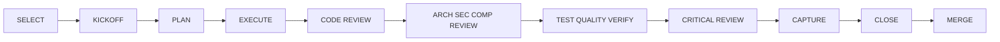

> **Documentation root (TD-178)**: paths below are written against the default `docs-copper/`. A
> project whose documentation lives elsewhere (for example `docs/`) is discovered automatically by
> the guard scripts, or pinned with `COPPER_DOCS_ROOT`. Read `docs-copper/` here as "the
> documentation root", not as a literal path.

# /cu:pipe

Track and guide the lean COPPER story delivery pipeline for: **$ARGUMENTS**

---

## Overview

This command is a **pure orchestrator** (v2.0.0) that manages a hardened delivery pipeline for
COPPER backlog stories. All substantive actions (review, quality gates, capture, closure) are
delegated to standalone commands. cu-pipe handles only YAML state management, stage advancement,
commit discipline, and the hard gate protocol.

**Migration from v1.x**: v2.0.0 is a breaking architectural change. The inline stage implementations
have been extracted into standalone commands. If you previously relied on cu-pipe performing reviews
inline, those reviews now happen via the delegated commands listed in the delegation table below.

State is stored in:

```text
docs-copper/roadmap/pipeline-audit-trail/<story-id>.yaml
```

Stage artefacts are stored in:

```text
docs-copper/roadmap/pipeline-audit-trail/artifacts/<story-id>-s<stage>-<type>.md
```

Any stage that produces a substantive deliverable (challenge log, implementation plan, review
findings, risk register, etc.) MUST write it to the `artifacts/` subfolder using the standardised
naming pattern. This ensures all pipeline deliverables are co-located and discoverable.

Pipeline stages:



---

## Delegation Reference Table

| Stage | Delegated Command(s)                                       | Expected Inputs                  | Expected Outputs                                                    | Artefact Path                                                      | Verification Method                                              |
| ----- | ---------------------------------------------------------- | -------------------------------- | ------------------------------------------------------------------- | ------------------------------------------------------------------ | ---------------------------------------------------------------- |
| S1    | `/cu:story-kickoff`                                        | Story ID, review profile         | Challenge log table, implementation plan, risk register             | `pipeline-audit-trail/artifacts/<id>-s1-kickoff.md`                | Challenge log has >= profile minimum entries; story file changed |
| S2    | Agent produces inline                                      | S1 challenge log, story ACs      | Implementation plan with alternatives and "what could go wrong"     | `pipeline-audit-trail/artifacts/<id>-s2-plan.md`                   | At least one alternative considered; risk section present        |
| S4    | `/cu:quality-review`                                       | Fresh-context inputs (Phase 4.7) | Structured findings table, PASS/FAIL status                         | (optional: `artifacts/<id>-s4-review.md` for significant findings) | `**Overall Status**:` line parsed                                |
| S5    | `/cu:arch-review`                                          | Fresh-context inputs (Phase 4.7) | Structured findings table, risk register, PASS/FAIL status          | (optional: `artifacts/<id>-s5-review.md` for significant findings) | `**Overall Status**:` line parsed; risk register present         |
| S6    | `/cu:qa-gate`                                              | Change surface, file list        | `quality_gates.status: pass\|fail`, verified_claims with exit codes | (none - evidence captured in YAML)                                 | Exit code 0 on all gates; verified_claims recorded               |
| S7    | `/cu:dod-verify`                                           | Fresh-context inputs (Phase 4.7) | PASS/FAIL/SKIP/WARN per criterion                                   | (none - evidence captured in YAML)                                 | All criteria have definitive status                              |
| S8    | `/cu:dev-journal` + `/cu:memory-update` + `/cu:readme-update` | Story context, change summary    | Journal file artifact, memory-bank updates, README file updates     | `docs-copper/dev-journal/YYYY/MM/YYYY-MM-DD-<slug>.md`             | Files exist on disk; closure_checks show pass                    |
| S9    | `/cu:story-update` + `/cu:readme-update`                   | Story ID, review outcomes        | Close docs committed; README updates; story stays In Progress       | (none - evidence captured in YAML)                                 | Close docs committed; story still In Progress (Done at merge)    |
| S10   | `/cu:mr-create` + `/cu:kanban` (post-merge)                | Branch, review outcomes          | MR URL, user confirms merge, then story Done + card DONE            | (none - MR is the deliverable)                                     | `pr_url`, `merge_approval` recorded; story Done; card in DONE    |

---

## Command Forms

```text
/cu:pipe init <story-id>
/cu:pipe status [story-id]
/cu:pipe next [story-id]
/cu:pipe complete [story-id]
/cu:pipe force <stage> "<reason>" [story-id]
```

---

## Phase 1: Parse Intent and Resolve Story

1. Parse `$ARGUMENTS` into: `init` | `status` | `next` | `complete` | `force`
2. Resolve story ID: (a) explicit in args, (b) branch pattern `feature/us-123-...`, (c) ask user
3. Validate story file exists under `docs-copper/roadmap/backlog/`

---

## Phase 2: Ensure Pipeline Location Exists

1. Ensure `docs-copper/roadmap/pipeline-audit-trail/` exists
2. Use `<story-id>.yaml` as state filename

---

## Phase 3: State Model

### YAML Shape

```yaml
schema_version: 2
story_id: US-123
story_path: docs-copper/roadmap/backlog/US-123-slug.md
feature_branch: ''
review_profile: standard
change_surface:
  code: false
  docs: true
  tests: false
  architecture: true
  security_sensitive: false
  compliance_sensitive: false
current_stage: S0_SELECT
status: active
status_reason: ''
initiated_at: '2026-05-07T00:00:00Z'
completed_at: ''
stages:
  S0_SELECT: { status: completed, completed_at: '', evidence: [], commit: '' }
  S1_KICKOFF: { status: pending, completed_at: '', reviewers: [], evidence: [], commit: '' }
  S2_PLAN: { status: pending, completed_at: '', reviewers: [], evidence: [], commit: '' }
  S3_EXECUTE: { status: pending, completed_at: '', reviewers: [], evidence: [], commit: '' }
  S4_CODE_REVIEW: { status: pending, completed_at: '', reviewers: [], evidence: [], commit: '' }
  S5_ARCH_SEC_COMP_REVIEW:
    { status: pending, completed_at: '', reviewers: [], evidence: [], commit: '' }
  S6_TEST_QUALITY_VERIFY:
    { status: pending, completed_at: '', reviewers: [], evidence: [], commit: '' }
  S7_CRITICAL_REVIEW: { status: pending, completed_at: '', reviewers: [], evidence: [], commit: '' }
  S8_CAPTURE: { status: pending, completed_at: '', reviewers: [], evidence: [], commit: '' }
  S9_CLOSE: { status: pending, completed_at: '', evidence: [], commit: '' }
  S10_MERGE: { status: pending, completed_at: '', evidence: [], commit: '' }
closure_checks:
  backlog_status: { status: pending, reason: '' }
  board_status: { status: pending, reason: '' }
  dev_journal: { status: pending, reason: '' }
  memory_bank: { status: pending, reason: '' }
  readme_review: { status: pending, reason: '' }
  commit_evidence: { status: pending, reason: '' }
  pr_readiness: { status: pending, reason: '' }
  pr_creation:
    { status: pending, reason: 'Created at S10 after all close docs committed and pushed' }
  deliverables_resolved: { status: pending, reason: '' }
  dod_verified: { status: pending, reason: '' }
quality_gates:
  lint: { status: pending, evidence: '' }
  unit_tests: { status: pending, evidence: '' }
  integration_tests: { status: pending, evidence: '' }
  functional_tests: { status: pending, evidence: '' }
  docs_quality: { status: pending, evidence: '' }
  validators: { status: pending, evidence: '' }
verified_claims: []
pr_readiness:
  { status: pending, branch: '', branch_clean: false, ready_for_pr: false, evidence: [] }
bypasses: []
notes: ''
```

### YAML Formatting Convention

The template above uses **flow style** (single-line) for the initial scaffold. When populating
evidence during pipeline execution, always expand to **block style** (multi-line) for readability:

```yaml
# BAD: flow style (hard to read in diffs and editors)
S0_SELECT: { status: completed, evidence: ['Created branch', 'Updated story'], commit: 'abc123' }

# GOOD: block style (readable, diff-friendly)
S0_SELECT:
  status: completed
  completed_at: '2026-05-14T10:00:00Z'
  evidence:
    - 'Created branch'
    - 'Updated story'
  commit: 'abc123'
```

Apply block style to: `stages.*`, `closure_checks.*`, `quality_gates.*`, `verified_claims`, and
`pr_readiness`. This matches the convention established by US-131 onwards.

### Status Enums (Two Levels)

The pipeline uses **two separate status enums** that MUST NOT be conflated:

**1. Pipeline Top-Level Status** (`status` field at YAML root):

`active` | `completed` | `abandoned`

| Value       | Meaning                                       | Transition                |
| ----------- | --------------------------------------------- | ------------------------- |
| `active`    | Story is in progress through the pipeline     | Initial state at `init`   |
| `completed` | All 11 stages done, S10 MERGE succeeded       | Set by Phase 5 `complete` |
| `abandoned` | Story dropped without completing the pipeline | Set by user disposition   |

**Critical rule**: Top-level status becomes `completed` only after S10 MERGE, not S9 CLOSE.

**2. Stage-Level Status** (each `stages.SX_*.status` field):

`pending` | `in_progress` | `completed` | `blocked` | `bypassed` | `abandoned`

| Value         | Meaning                                      | Used For           |
| ------------- | -------------------------------------------- | ------------------ |
| `pending`     | Stage not yet started                        | Initial state      |
| `in_progress` | Stage currently being executed               | Active stage       |
| `completed`   | Stage finished with verified evidence        | Done stage         |
| `blocked`     | Stage cannot proceed (dependency/decision)   | Hard gate hold     |
| `bypassed`    | Stage skipped with recorded justification    | Soft gate skip     |
| `abandoned`   | Stage abandoned (story dropped mid-pipeline) | Pipeline cancelled |

**3. Story Frontmatter Status** (in the Markdown story file under `docs-copper/roadmap/backlog/`):

The canonical story-lifecycle set , defined ONCE in `tools/status-vocabulary.json` and loaded by
both `pipeline_validator.py` and `user-story-validator.py` (TD-171 AC3):

`Draft` | `Ready` | `In Progress` | `Done` | `Blocked` | `Cancelled`

| Value         | Meaning                          | Pipeline Mapping                             |
| ------------- | -------------------------------- | -------------------------------------------- |
| `Draft`       | Story not yet groomed            | No pipeline record                           |
| `Ready`       | Groomed, actionable, not started | No pipeline record (or parked pre-S1)        |
| `In Progress` | Story being worked on            | Pipeline `active`, some stages `in_progress` |
| `Done`        | Story fully delivered and merged | Pipeline `completed`                         |
| `Blocked`     | Story cannot proceed             | Pipeline `active`, stage `blocked`           |
| `Cancelled`   | Story dropped                    | Pipeline `abandoned` (if one exists)         |

**Cross-Reference Consistency Rule**: When the pipeline top-level status is `completed`, the story
frontmatter status MUST be `Done`. When the story frontmatter is `Done`, the pipeline top-level
status MUST be `completed` (records quarantined as `schema_version: 1` are exempt , they are legacy
histories, skipped and counted by the audit). Violations are caught by TWO independent mechanisms:
`tests/regression/test_pipeline_status_consistency.py` (self-contained corpus test in the pytest
suite) and the `pipeline-validator audit` gate line in `deploy/local_ci.py`, mirrored in
`.github/workflows/quality.yml` (TD-171 AC5).

### Bypass Record

```yaml
bypasses:
  - stage: S5_ARCH_SEC_COMP_REVIEW
    reason: 'Docs-only release path accepted'
    risk_accepted: 'Lightweight review performed'
    approved_by: 'Maintainer'
    timestamp: '2026-05-07T00:00:00Z'
```

### Verified Claim Shape

```yaml
verified_claims:
  - claim: 'Framework pytest suite passes'
    command: 'uv run pytest tests/ --tb=short -q'
    expected: 'exit_code=0'
    actual: 'exit_code=0'
    exit_code: 0
    scope: 'framework'
    category: 'test_suite'
```

Required fields: `claim`, `command`, `expected`, `actual`, `exit_code`, `scope`, `category`.

---

## Phase 4: Stage Definitions

| Stage | Purpose                                     | Evidence Expectation                                                                                                                                                       |
| ----- | ------------------------------------------- | -------------------------------------------------------------------------------------------------------------------------------------------------------------------------- |
| S0    | Confirm story, create branch, create YAML   | branch created, story status In Progress, Kanban TODO -> DOING                                                                                                             |
| S1    | Critically refine scope, ACs, dependencies  | challenge log (per profile minimum), story file updated                                                                                                                    |
| S2    | Define execution approach with alternatives | implementation plan with alternatives and "what could go wrong"                                                                                                            |
| S3    | Produce working artefacts                   | changed files linked to story intent, AC self-review                                                                                                                       |
| S4    | Formal code/content review                  | `/cu:quality-review` output with PASS/FAIL status (fresh-context review, Phase 4.7)                                                                                        |
| S5    | Architecture, security, compliance review   | `/cu:arch-review` findings and risk register (fresh-context review, Phase 4.7); full audit (`cu:security-audit`) for a security-sensitive story, else the trust-boundary line |
| S6    | Test and quality verification               | `/cu:qa-gate` output with verified_claims and exit codes                                                                                                                   |
| S7    | Critical readiness review                   | `/cu:dod-verify` output (fresh-context review, Phase 4.7), challenge log, perspectives                                                                                     |
| S8    | Capture continuity and narrative            | dev-journal + memory-bank + readme-update executed                                                                                                                         |
| S9    | Close internal bookkeeping                  | close docs committed (no push yet); story stays In Progress                                                                                                                |
| S10   | Push, create MR, await merge, then close    | push, MR created, user confirms merge; POST-MERGE story -> Done + card -> DONE                                                                                             |

---

## Phase 4.1: Critical Thinking Protocol

Before advancing any stage from S1 onward, answer these four mandatory questions:

1. **Challenge**: What assumption am I making that could be wrong?
2. **Sceptic**: What would a reasonable sceptic say?
3. **Gap**: What am I not seeing?
4. **Downstream**: If this is wrong, what breaks?

### Challenge Log Format

```markdown
| #   | Aspect | Challenge             | Disposition              | Status                     |
| --- | ------ | --------------------- | ------------------------ | -------------------------- |
| 1   | Scope  | <question or concern> | <resolution or decision> | resolved / open / deferred |
```

### Minimum Entries by Profile

| Profile       | S1 minimum | S7 minimum                     |
| ------------- | ---------- | ------------------------------ |
| `lightweight` | 2          | 2 perspectives, 1 entry each   |
| `standard`    | 3          | 2 perspectives, 2 entries each |
| `hardened`    | 5          | 3 perspectives, 2 entries each |

### Anti-Patterns

- Confirmation bias, mechanical review, deferred criticality, vague evidence

---

## Phase 4.5: Story Document Maintenance

Pipeline commands (`init`, `complete`, `force`) are explicit permission to update the story document
and Kanban board via `/cu:story-update` and `/cu:kanban`.

### Progress Update Checkpoints

| Stage | Progress Entry                                     |
| ----- | -------------------------------------------------- |
| S0    | Story selected, branch created, pipeline initiated |
| S1    | Scope refined, ACs reviewed, profile chosen        |
| S3    | Execution completed, artefacts produced            |
| S8    | Dev-journal, memory-bank, readme-update captured   |
| S9    | Close docs committed (status/board flip at merge)  |
| S10   | Pushed, MR created, merged; story Done, card DONE  |

Format: `> - **YYYY-MM-DD**: [SX_STAGE] One-line summary`

### Kanban Board Transitions

Delegate to `/cu:kanban`:

| Transition     | From    | To        | Character                                                      |
| -------------- | ------- | --------- | -------------------------------------------------------------- |
| Work started   | `TODO`  | `DOING`   | `- [ ]` -> `- [/]`                                             |
| Work merged    | `DOING` | `DONE`    | `- [/]` -> `- [x]` (post-merge, with the status flip , TD-173) |
| Work abandoned | `DOING` | `CARPARK` | `- [/]` -> `- [-]`                                             |

### Story Frontmatter Status

| Event               | `status`                                                        |
| ------------------- | --------------------------------------------------------------- |
| init (S0)           | `In Progress`                                                   |
| complete at S9      | `In Progress` (unchanged , close docs only)                     |
| **after the merge** | `Done`, together with top-level `status: completed` in the YAML |
| force abandon       | `Blocked`                                                       |

**A story is `Done` only when its pipeline is `completed`, which happens at or after the merge**
(TD-173). S9 commits the close documentation; it does not assert delivery. Setting `Done` at S9 was
unsatisfiable: `verify S9_CLOSE` demanded it while `audit` refuses `Done` whilst the pipeline is
active, and with S10 pending the pipeline cannot be `completed`. The status flip belongs in the
post-merge close: a `chore/<story-id>-close` branch cut from the updated `main`, one commit, its own
PR, merged only on a second explicit approval (TD-205; for example PRs #266 and #268).

---

## Phase 4.6: Commit Discipline

### Commit Checkpoint Stages

| Stage | Commit Message Pattern                               |
| ----- | ---------------------------------------------------- |
| S1    | `docs(<story-id>): complete S1 : <one-line summary>` |
| S3    | `docs(<story-id>): complete S3 : <one-line summary>` |
| S6    | `docs(<story-id>): complete S6 : <one-line summary>` |
| S9    | `docs(<story-id>): S9 close documentation`           |

### Commit Procedure

For each checkpoint stage:

1. Stage all changed files with `git add`
2. If no files changed: record `commit: skipped (no changes)` in evidence
3. Create commit: `git commit -m "docs(<story-id>): complete S<stage> : <summary>"`
4. Record commit hash in pipeline YAML stage entry under `commit`

### Test tiers (TD-195)

Run the cheapest check that can catch what the stage changed; the full battery is for the stages
that assert merge-readiness.

| Stage              | Tier                                                                                                                                                   |
| ------------------ | ------------------------------------------------------------------------------------------------------------------------------------------------------ |
| S0-S2, S8          | none required (state and documentation); run any guard the change touches                                                                              |
| S3, S4, S5, S7, S9 | **fast tier**: `npm run ci:local:fast` (governance gates, plus pytest without `slow` and `battery_duplicate`, no coverage), plus the tests you changed |
| S6, S10            | **full battery**: `npm run ci:local` on the exact commit, all green                                                                                    |

A test marked `battery_duplicate` re-runs a battery gate verbatim, so the battery skips it and plain
`pytest` still runs it; the comment above each marker names the gate. A test marked `slow` is
skipped by the fast tier only, never by the battery.

### S10 Merge Readiness

**Final full-quality-battery re-run (MANDATORY, before push).** The S6 quality gate ran earlier in
the story; commits at S7 (review fixes), S8 (capture), and S9 (close) have since changed the tree,
so the S6 evidence is stale relative to the exact commits about to be pushed. Before pushing, run
`npm run ci:local` on current HEAD. It runs every gate (tests and coverage, lint, validators, the
determinism gates) and must exit 0: exit 1 is a failure, and exit 2 means a gate could not be run
(for example capability kits are installed), so neither is a pass.

If the battery is not exit 0, S10 STOPS: fix on the branch and re-run before pushing. Record the
result (commit, passed/failed/skipped, exit code) in S10 evidence AND in the PR body. GitHub Actions
is disabled (ADR-007): no check runs after the push, so this battery on the pushed commit IS the
merge verification, not a pre-check before one.

Then:

1. `git rev-list --count main..HEAD` must be > 0
2. Record `commit_count: <N>` in S10 evidence
3. Record the merged PR head as `pr_head:` (40 characters), the PR URL as `pr_url:` and, in the
   evidence, a line `Changed after review: <files>` listing every file changed between the latest
   `reviewed_commit` and that head (US-395): `pipeline_validator.py verify S10_MERGE` checks each
   reviewed commit is an ancestor of the head and every such file is listed. A merge of `main` after
   the latest review puts its files in that list too: list them (noisy, but safe).

**Approval and head (TD-205; the story PR and the close PR alike).** A merge approval covers the PR
head it was given for, tested by the battery above. Before merging, run `git fetch origin` and check
the PR branch is up to date with the default branch (`main` here):
`git rev-list --count HEAD..origin/main` is 0, so the merge result is what was tested. Any new head
after the battery or the approval (a merge of `main`, a fix) needs, in order: `npm run ci:local` on
it, the result in the evidence and the PR body, then a fresh approval naming what changed. If `main`
moves again after one such refresh, stop and ask the user whether to refresh again or merge with the
untested gap recorded in the evidence (Rule 07 Control 1: an exit, not a loop). Merge on the
platform (the PR or MR merge, as `/cu:mr-create` detects it), never by a local merge and push.

**Merge approval record (US-399).** In the S10 stage, record what the user said, not a paraphrase:

```yaml
S10_MERGE:
  pr_head: '<40-character head that was merged>'
  pr_url: 'https://github.com/<owner>/<repo>/pull/<n>'
  merge_approval:
    quote: '<the approving sentence, verbatim>'
    at: '<date -u +%Y-%m-%dT%H:%M:%SZ, run when the approval arrives>'
    head: '<the 40-character head it approved, equal to pr_head>'
```

The quote is the approving sentence only, never other text from the reply: the record is committed.
After a refresh (above), record the approval of the head that was merged; earlier ones may stay in
the evidence. The close PR's own approval goes in the close PR's evidence and body: the close PR
merges this record, so it cannot hold its own approval. `pipeline_validator.py verify S10_MERGE`
fails when a field is missing, `at` is not an ISO 8601 date and time, `head` is not `pr_head`,
`pr_head` is not in the default branch (the one `origin/HEAD` names, else `main`; fetch first), or
`pr_url` is not a PR URL; it reports the quote as recorded, not proven (proof is US-402). Records
whose S10 completed before 2026-11-13, and legacy `schema_version: 1` records, are reported not
checked (a warning, never counted as checked).

The ancestry test assumes a merge commit, as the platform merge above makes. After a squash or
rebase merge, or in a clone without `origin/HEAD` whose default branch is not `main` (run
`git remote set-head origin -a`), it fails although the PR merged. Then stop and tell the user;
record the failure in the S10 evidence as unverified, never change `pr_head` to make it pass (Rule
07 Control 1: an exit, not a workaround).

### S10 Post-merge Close (TD-173, TD-202, TD-205)

After the story PR is merged, close the story through a second PR. Never commit or push on `main`:
an adopter's repository may have no hook to stop it.

1. Update the local default branch (`git checkout main && git pull --ff-only`; it now holds the
   story merge), then cut `chore/<story-id>-close` from it. Read the story PR's merge commit from
   the platform (for example `gh pr view <n> --json mergeCommit`) for the S10 evidence.
2. In ONE commit, make the close changes the S10 row of Phase 5 lists (story `Done`, card DONE,
   pipeline `completed`, the story PR's S10 evidence, the epic's counters); they move together.
3. Run `npm run ci:local` on that commit; exit 0 only; its result goes in the close PR's body.
4. Push the close branch (user confirmation) and open its PR with `/cu:mr-create`.
5. Merge it only on a **second explicit approval**: the S10 approval covers the story PR, not the
   close PR (TD-205), and only under **Approval and head** above.
6. If `main` moved (with or without a conflict, for example another close changed the same board or
   epic): merge `main` into the close branch and regenerate generated files (`DEPENDENCIES.md`);
   that is a new head, so **Approval and head** applies (battery, PR body, fresh approval).

---

## Phase 4.7: Hard Gate Protocol (S4-S7)

### Fresh-context review (S4, S5, S7)

At S4, S5 and S7, for every review profile, the review runs in two passes (US-395), as set out in
`${CLAUDE_PLUGIN_ROOT}/skills/framework-authoring/resources/fresh-context-review.md`:

1. **Fresh reviewer first**: a separate subagent, never a fork or other context-inheriting mode,
   whose prompt carries paths only: the review command, the story file, the diff pinned at the
   reviewed commit (`git diff <default branch>...<reviewed commit>`), the ADRs the story names, the
   resource above, and, for `/cu:dod-verify`, the pipeline status output
   (`pipeline_validator.py status`). Never the build conversation, the S2 plan rationale, the
   author's self-review or earlier findings. Its report opens with an `## Inputs` section listing
   exactly what it was given.
2. **Then the author** adds its own review, knowing the intent.
3. **One findings table** with a `Source` column (`fresh`, `author`, or both).
4. **The stage records** `reviewed_commit:` (the 40-character SHA the fresh reviewer read) and,
   under `reviewers:`, the reviewer, its inputs and `Verdict dictated: no`. A review stage that
   completed before this rule records `reviewed_commit: 'not recorded: <reason>'`, which the S10
   check lists as not checked; never backfill a commit a reviewer did not read.

When no fresh reviewer is possible (no subagent tool, the reviewer cannot start, the host's
isolation is not measured, or the reviewer was given anything the exclusions list), the author
reviews inline and the report and the stage evidence say `Not independent: <reason>`. A review that
is not independent is never presented as if it were.

### Stop-and-Present Protocol

At stages S4 through S7, cu-pipe MUST:

1. **Delegate** the stage to the appropriate command (see delegation table), running the
   fresh-context review above at S4, S5 and S7
2. **Collect** the structured output from the command
3. **STOP** and present findings to the user with:
   - Summary of findings (severity, count)
   - The PASS/FAIL status
   - Numbered options for user disposition
4. **Wait** for user response before advancing

### Mandatory Question Format

```
## S4 CODE REVIEW - Hard Gate

**Status**: PASS | FAIL
**Findings**: <count> (Critical: <n>, High: <n>, Medium: <n>, Low: <n>)
**Reviewer**: fresh subagent (inputs: <list>) then author | Not independent: <reason>

| #   | Severity | Source | File            | Issue | Recommendation |
| --- | -------- | ------ | --------------- | ----- | -------------- |
| 1   | High     | fresh  | path/to/file:42 | ...   | ...            |

What would you like to do?
[A] Accept findings and advance to S5
[B] Review specific finding in detail (specify which)
[C] Block advancement - require fixes before S5
[D] Bypass with accepted risk (requires reason)
```

### Evidence Recording

After user disposition, record in pipeline YAML:

```yaml
S4_CODE_REVIEW:
  reviewed_commit: '<40-character SHA>'
  reviewers:
    - 'Fresh reviewer: general-purpose subagent; inputs: story, git diff main...<sha>, ADR-0NN;
      Verdict dictated: no'
    - 'Author pass after the fresh report'
  evidence:
    - 'Delegated to /cu:quality-review: PASS, 2 medium findings'
    - 'User disposition: [A] Accept and advance'
    - 'Findings: 0 critical, 0 high, 2 medium, 1 low, 3 info'
```

---

## Phase 4.8: Stage-End Evidence Presentation (ALL stages)

Every stage completion MUST present evidence to the user. The interaction depth varies:

### S0-S3, S8-S10: Acknowledgement Only

Present a summary of what was accomplished, then wait for the user to acknowledge ("continue" or
equivalent) before advancing. No mandatory questions required.

### S4-S7: Full Hard Gate

Present evidence AND mandatory questions with numbered options per Phase 4.7. Block advancement
until user responds.

---

## Two-Layer Enforcement

### Layer 1: Individual Commands

Each delegated command independently enforces quality and presents structured output with PASS/FAIL
status. This is the command's own enforcement, built into its instruction text.

### Layer 2: cu-pipe Verification

cu-pipe verifies that: (a) the delegated command was invoked, (b) structured output was produced,
(c) the PASS/FAIL status is acceptable. Both layers must pass for a stage to advance.

If either layer fails, cu-pipe blocks stage advancement and reports the failure.

---

## Phase 4.9: Mandatory Evidence Verification Protocol

**This protocol is the primary hardening mechanism.** No stage may be marked `completed` until its
evidence has been verified on disk. Self-attestation without disk-level proof is rejected.

### Tool: `pipeline-validator`

Evidence verification is enforced by the `pipeline-validator` engine,
`${CLAUDE_PLUGIN_ROOT}/tools/pipeline_validator.py`. cu-pipe MUST invoke it at every stage boundary.

On OpenCode 2 the deploy registers it as the `pipeline-validator` tool through its
`cu-pipeline-validator` plugin (TD-207, ADR-056). The tool answers `pass`, `fail` or `unverified`;
`unverified` (the script could not run or check: no Python with PyYAML, scripts changed since the
deploy, a timeout) is never a pass, and its notes say why. Where no tool is registered (another
host, the plugin missing), run the script directly and read its JSON and exit code (0 pass, 1 fail,
2 could not check), for example
`python3 ${CLAUDE_PLUGIN_ROOT}/tools/pipeline_validator.py verify <story-id> <stage> --root .` (`${CLAUDE_PLUGIN_ROOT}/tools/`
on Claude Code).

**Three actions**:

| Action   | Invocation                                                                | When Used                                                                                                                                                                                                                      |
| -------- | ------------------------------------------------------------------------- | ------------------------------------------------------------------------------------------------------------------------------------------------------------------------------------------------------------------------------ |
| `verify` | `pipeline-validator(action="verify", story_id="<id>", stage="S<X>_NAME")` | Before marking any stage `completed`                                                                                                                                                                                           |
| `status` | `pipeline-validator(action="status", story_id="<id>")`                    | At `status` command, before advancing                                                                                                                                                                                          |
| `audit`  | `pipeline-validator(action="audit")`                                      | At `init` to check overall health; also a standing CI gate (`deploy/local_ci.py` + `quality.yml`, TD-171 AC5) over the FULL corpus (`*.yaml`, all story-id prefixes; `schema_version: 1` records reported as `legacy_skipped`) |

### Verification Procedure

Before recording any stage as `completed`, cu-pipe MUST:

1. **Invoke**: Call `pipeline-validator` with `action="verify"`, passing the story ID and current
   stage key
2. **Inspect**: Review the JSON output - specifically `passed`, `errors`, and `warnings`
3. **Decide**:

   - If `passed == true`: mark stage `completed`, record `completed_at`
   - If `passed == false` and `errors` is non-empty: REJECT stage completion, report to user:

     ```
     ## S<X> EVIDENCE VERIFICATION FAILED

     Missing evidence:
     - [ ] <errors[0]>
     - [ ] <errors[1]>

     Stage completion REJECTED. Resolve the missing evidence before retrying.
     ```

4. **No bypass**: Evidence verification failures cannot be bypassed with `force`

### Per-Stage Verification Rules (Implemented in pipeline_validator.py)

| Stage | Checks Performed by `pipeline-validator verify`                                                                                                                        |
| ----- | ---------------------------------------------------------------------------------------------------------------------------------------------------------------------- |
| S0    | Feature branch exists; YAML state file parseable; story status is In Progress                                                                                          |
| S1    | Kickoff artefact file exists; story file changed since S0; evidence non-empty                                                                                          |
| S2    | Plan artefact file exists; evidence non-empty                                                                                                                          |
| S3    | Evidence non-empty; commits exist since S2                                                                                                                             |
| S4    | Evidence contains PASS/FAIL status indicator                                                                                                                           |
| S5    | Evidence contains PASS/FAIL status indicator; `security_review` (US-393): the redacted summary, digest and coverage ledger, or the trust-boundary line                 |
| S6    | Evidence contains PASS/FAIL; `quality_gates` all pass                                                                                                                  |
| S7    | Evidence contains PASS/FAIL/SKIP/WARN status indicator                                                                                                                 |
| S8    | Dev-journal file exists on disk (extracted from `closure_checks.dev_journal`); evidence non-empty                                                                      |
| S9    | Story frontmatter status is `In Progress` (TD-173 , `Done` is asserted at S10); evidence non-empty                                                                     |
| S10   | Evidence; story Done; reviewed commits; `merge_approval` (quote, ISO `at`, `head` = `pr_head`, in the default branch) and `pr_url` form; recorded, not proven (US-399) |

### S8-Specific Hardening

S8 has historically been the stage where evidence gaps accumulate. For S8 specifically.

**S8 is documentation capture, and it is delegated, not improvised. The three capture commands MUST
be INVOKED, in this order:**

1. **`/cu:dev-journal`** , create the session journal entry.
2. **`/cu:memory-update`** , synchronise the Memory Bank (the command performs its own full review of
   all 6 files; do NOT substitute ad-hoc hand-edits to one or two files).
3. **`/cu:readme-update`** , review and update README.md files affected by the story's changes (run
   it against the folder(s) the story touched).

**Anti-shortcut rule**: producing an _equivalent_ artefact by hand (writing the journal inline,
hand-editing `activeContext.md`, manually tweaking a README) does NOT satisfy S8. The commands carry
their own rigour (memory-update reviews all 6 bank files; readme-update sweeps a folder hierarchy
and checks cross-references); skipping the command skips that rigour. If a capture command cannot be
invoked in the current environment, record WHY in the stage evidence and flag it to the user , do
not silently substitute manual work.

**Disk-level verification (a stage may not be marked completed until all pass):**

1. **Dev-journal**: the file path recorded in `closure_checks.dev_journal` MUST resolve to an
   existing file. Verification: `test -f <path>` returns 0.
2. **Memory-bank**: `/cu:memory-update` was invoked AND at least `activeContext.md` and `progress.md`
   were modified during this pipeline run. Verification:
   `git diff --name-only HEAD~1 -- memory-bank/` includes these files.
3. **README update**: `/cu:readme-update` was invoked for the story's touched folder(s).
   Verification: README files changed in working tree or last commit (or, if none needed changing,
   the stage evidence records that `/cu:readme-update` ran and found nothing to update).

If any of these three checks fail, S8 completion is REJECTED regardless of other evidence.

---

## S5 Formal Review Protocol

S5 delegates to `/cu:arch-review` which produces:

1. **Structured findings table**: severity, category, issue, recommendation
2. **Risk register**: risk ID, description, probability, impact, mitigation
3. **PASS/FAIL status**

cu-pipe presents the full findings table and risk register to the user with disposition options.
User disposition is recorded in pipeline YAML evidence.

### Security review (US-393)

The security method is the core `cu:security-audit` skill (`${CLAUDE_PLUGIN_ROOT}/skills/security-audit/SKILL.md`).
Which evidence S5 needs depends on the record's `change_surface.security_sensitive`;
`pipeline_validator.py verify <story> S5_ARCH_SEC_COMP_REVIEW` checks it (the `security_review`
check).

**A security-sensitive story** runs the `cu:security-audit` skill in full-audit mode, as the
maintainer's request for its report artefacts: the skill's six phases, its own fresh hunters and
verifiers, and its output directory outside the repository (the skill's default, or one the
maintainer names). The run is scoped to the story's changed paths and may take a strict agent
budget; an exhausted budget leaves `run_status: "incomplete"`, and S5 reports the gap.

The full `findings.json` stays out of version control: it holds traces and reproduction detail, and
Medium, Low and `needs_validation` records may outlive the merge (D20). Into the story's artefact
folder go only a redacted summary, `<story-id>-s5-findings-summary.json` (a JSON list of
`{fingerprint, verdict, severity, title, disposition}`, nothing else), and the coverage ledger,
`<story-id>-s5-coverage-ledger.json`. The S5 evidence names them, the digest of the full file, where
the full file lives, and the commit the audit read (`<audit trail>` is the pipeline audit-trail
folder under the documentation root):

```yaml
- 'Findings summary: <audit trail>/artifacts/US-123-s5-findings-summary.json'
- 'Findings digest: sha256:<64 hex>'
- 'Findings JSON: ~/security-audit-skill/<repo>/run-<N>/findings.json'
- 'Coverage ledger: <audit trail>/artifacts/US-123-s5-coverage-ledger.json'
- 'Audit source ref: <40-hex commit>'
```

In the template's terms the lines are `Findings summary: <path>`, `Findings digest: sha256:<hex>`,
`Findings JSON: <path>`, `Coverage ledger: <path>` and `Audit source ref: <commit>`; each line holds
its value only, and the files are this story's (`<story-id>-s5-`), reached through no symbolic link.
The check runs the skill's validators (`node` required; missing, it fails and says so; on a platform
without `O_NOFOLLOW`, such as Windows, the validators refuse every input, so S5 fails closed there).
The ledger must show coverage (at least one unit, none still open, one covered) and must have
reviewed every changed path the trust-boundary list matches, and at least one changed path. The
summary's dispositions enforce the severity rule: a confirmed `critical` or `high` is `fixed`; a
confirmed `medium` or `low` is `fixed` or `filed:<STORY-ID>`. The audit source ref must be a commit
of this story's branch. When the full file is present on the machine running the check, it must be
untracked (outside the repository or ignored), pass its validator, match the digest and agree with
the summary; when it is absent, the check warns that it did not compare them.

The fresh `/cu:arch-review` (Phase 4.7) still runs; the audit's records join its findings in one
findings table with a `Source` column (`fresh`, `audit`, `author`). Critical and High findings are
fixed before the merge (S5 stays FAIL until then); Medium and Low findings may be filed as a story,
and the summary names it.

**A story that is not security-sensitive** states in its S5 evidence
`no trust boundary touched: <reason>`. When its diff (the default branch against the record's
`feature_branch`, renames counted on both sides; an empty diff is an error) touches a path in the
project's trust-boundary list, `trust-boundary-paths.json` in the pipeline audit-trail folder, it
states `trust boundary touched, not security-sensitive: <reason>` instead. The list is read from the
default branch, never from the branch under review, so a story cannot edit the list that judges it.
A project with no list there gets a warning that the path check did not run, never a pass.

**Execution safety**: the pipeline never runs target code without the sandbox controls the skill
lists; without them, the review stays source-only and says so (findings it could not reproduce are
`needs_validation`).

---

## S8 User Hold Protocol

Before advancing past S8, cu-pipe MUST perform disk-level verification of all S8 deliverables, then
present the verified evidence:

1. **Verify dev-journal**: Confirm `test -f docs-copper/dev-journal/YYYY/MM/YYYY-MM-DD-<slug>.md`
   returns 0. If the file does not exist, REJECT S8 completion.
2. **Verify memory-bank**: Confirm `activeContext.md` and `progress.md` have been modified during
   this pipeline run.
3. **Verify readme-update**: Confirm `/cu:readme-update` was executed (README files changed).

Only after all three verifications pass, present the hold:

- Dev-journal location and file existence
- Memory-bank files updated
- `/cu:readme-update` execution and files changed

Then asks:

```
## S8 CAPTURE - User Hold

Evidence:
- Dev-journal: docs-copper/dev-journal/YYYY/MM/YYYY-MM-DD-<slug>.md (VERIFIED: file exists on disk)
- Memory bank: activeContext.md, progress.md, systemPatterns.md (VERIFIED: files modified)
- README update: N files updated via /cu:readme-update (VERIFIED: command executed)

What would you like to do?
[A] Confirm and advance to S9 (CLOSE)
[B] Review capture artefacts before advancing
[C] Hold - do not advance yet
```

Record user decision in pipeline YAML evidence before advancing.

---

## Phase 5: Intent Behaviour

### `init <story-id>`

1. Resolve the story
2. Call `pipeline-validator(action="audit")` to check overall pipeline health
3. Ensure pipeline directory exists
4. Create feature branch: `feature/<story-id>-<slug>` (skip if already on matching branch)
5. Create YAML state file on the feature branch
6. Record branch name in YAML
7. Mark S0 completed, set current_stage to S1
8. Call `pipeline-validator(action="verify", story_id, stage="S0_SELECT")` to confirm S0 evidence
9. Delegate to `/cu:story-update`: insert S0 progress entry, set status In Progress, update
   last_modified
10. Delegate to `/cu:kanban`: move card TODO -> DOING
11. Present S0 evidence (acknowledgement mode per Phase 4.8)

### `status [story-id]`

1. Resolve the story
2. Call `pipeline-validator(action="status", story_id)` to get validated pipeline state
3. Present: current stage, completed stages, pending stages, bypass history, next expected evidence,
   any warnings from the validator

### `next [story-id]`

1. Resolve the story
2. Read YAML state file
3. Present checklist for the next pending stage with expected evidence

### `complete [story-id]`

1. Resolve the story, read YAML state file
2. Treat as **advance and complete the current stage**
3. **Call `pipeline-validator(action="verify", story_id, stage)` for the current stage**. If
   `passed == false`, REJECT stage completion immediately and present the `errors` array to the
   user. Do not proceed to step 4.
4. **Stage-specific delegation and verification**:

| Stage | Action                                                                                                                                                                                                                                                                                                                                                                                                                                                                                                                                                                                                                                                                                                                                                                                                                                                                                                 |
| ----- | ------------------------------------------------------------------------------------------------------------------------------------------------------------------------------------------------------------------------------------------------------------------------------------------------------------------------------------------------------------------------------------------------------------------------------------------------------------------------------------------------------------------------------------------------------------------------------------------------------------------------------------------------------------------------------------------------------------------------------------------------------------------------------------------------------------------------------------------------------------------------------------------------------ |
| S1    | Delegate to `/cu:story-kickoff`. **Story update gate (AC14)**: verify story file has changed since S0 (`git diff` on story file); if unchanged, REJECT S1 and require challenge findings to be applied. Verify challenge log has >= profile minimum entries. Write artifact to `pipeline-audit-trail/artifacts/<story-id>-s1-kickoff.md`. Delegate to `/cu:story-update` for progress entry.                                                                                                                                                                                                                                                                                                                                                                                                                                                                                                           |
| S2    | Agent produces implementation plan inline (no delegation needed). Verify: at least one alternative considered, "what could go wrong" section present. Write artifact to `pipeline-audit-trail/artifacts/<story-id>-s2-plan.md`.                                                                                                                                                                                                                                                                                                                                                                                                                                                                                                                                                                                                                                                                        |
| S3    | Agent produces deliverables inline. Self-review against each AC. Record deviation log if execution diverged from plan.                                                                                                                                                                                                                                                                                                                                                                                                                                                                                                                                                                                                                                                                                                                                                                                 |
| S4    | Delegate to `/cu:quality-review` as a fresh-context review (fresh reviewer, then author). Collect structured output. Apply hard gate protocol (Phase 4.7).                                                                                                                                                                                                                                                                                                                                                                                                                                                                                                                                                                                                                                                                                                                                             |
| S5    | Delegate to `/cu:arch-review` as a fresh-context review (fresh reviewer, then author). For a security-sensitive story, also run the full audit (S5 Formal Review Protocol). Collect findings table + risk register. Apply hard gate protocol (Phase 4.7) AND formal review protocol.                                                                                                                                                                                                                                                                                                                                                                                                                                                                                                                                                                                                                   |
| S6    | Delegate to `/cu:qa-gate`. Collect verified_claims. Apply hard gate protocol (Phase 4.7). Block on any non-zero exit code.                                                                                                                                                                                                                                                                                                                                                                                                                                                                                                                                                                                                                                                                                                                                                                             |
| S7    | Delegate to `/cu:dod-verify` as a fresh-context review: each AC clause cited at its `path:line`. Collect PASS/FAIL/SKIP/WARN per criterion. Apply hard gate protocol (Phase 4.7).                                                                                                                                                                                                                                                                                                                                                                                                                                                                                                                                                                                                                                                                                                                      |
| S8    | **INVOKE** `/cu:dev-journal`, then `/cu:memory-update`, then `/cu:readme-update` (in that order , do NOT hand-author equivalents; see S8-Specific Hardening anti-shortcut rule). Verify file artefacts exist on disk. Apply user hold protocol (Phase 4.8).                                                                                                                                                                                                                                                                                                                                                                                                                                                                                                                                                                                                                                               |
| S9    | Delegate to `/cu:story-update` (progress entry; status stays In Progress) and `/cu:readme-update`. Commit all close docs. Verify: close docs committed. The status/board flip to Done/DONE happens POST-MERGE (TD-173) , setting it here is unsatisfiable against the audit.                                                                                                                                                                                                                                                                                                                                                                                                                                                                                                                                                                                                                           |
| S10   | **Re-run the full quality battery on current HEAD (S10 Merge Readiness, MANDATORY) , all green before push.** Then **push** branch to origin (requires user confirmation). Delegate to `/cu:mr-create`, present merge readiness summary, **stop and ask user to confirm merge**. After user confirms: merge it, then close by PR, per **S10 Post-merge Close**, never on `main`: `status: Done`, delegate to `/cu:kanban` (DOING -> DONE), set top-level `status: completed`, `completed_at`. **Atomically** , the audit refuses a `completed` pipeline over a story that is not `Done`, and refuses a `Done` story over an `active` pipeline, so the three must move together (TD-173). In the same commit, update the parent epic's stated counters (and its status, if this was its last open child): `epic-validator.py` recounts them from the children and fails the battery otherwise (TD-202). |

5. For checkpoint stages (S1, S3, S6, S9): execute commit procedure (Phase 4.6)
6. Record timestamp, reviewers, evidence
7. Apply stage-end evidence presentation (Phase 4.8)
8. Move current_stage to next pending
9. If S10 complete: set top-level status to `completed`, populate `completed_at`

### `force <stage> "<reason>" [story-id]`

1. Resolve the story
2. Validate stage exists, require non-empty reason, risk_accepted, approved_by
3. Refuse bypasses for S8, S9, and S10
4. Append bypass entry, mark stage as `bypassed`
5. Advance current_stage
6. Delegate to `/cu:story-update` for progress entry noting bypass
7. Delegate to `/cu:kanban` if abandoned (DOING -> CARPARK)

---

## Phase 6: Evidence Heuristics

When giving guidance, inspect the most relevant artefacts:

- **Story source**: `docs-copper/roadmap/backlog/`
- **Analysis notes**: `docs-copper/roadmap/analysis/`
- **Pipeline artifacts**: `docs-copper/roadmap/pipeline-audit-trail/artifacts/` (stage deliverables)
- **Implementation changes**: working tree or recent commits
- **Review evidence**: delegated command output (structured findings, PASS/FAIL)
- **Test and quality evidence**: `/cu:qa-gate` output, verified_claims
- **Capture evidence**: `docs-copper/dev-journal/`, `docs-copper/memory-bank/`
- **Close evidence**: `/cu:mr-create` output, story status, board status, MR confirmation

### Closure Checklist

Each item includes a verification method. S9 completion is REJECTED if any mandatory item fails
verification.

| #   | Item                                   | Verification Method                                      | Mandatory |
| --- | -------------------------------------- | -------------------------------------------------------- | --------- |
| 1   | backlog story status -> Done           | Story frontmatter `status: Done` (verified POST-MERGE)   | S10       |
| 2   | board status -> DONE                   | `/cu:kanban` confirms card in DONE (verified POST-MERGE) | S10       |
| 3   | dev-journal created (file on disk)     | `test -f <journal-path>` returns 0                       | YES       |
| 4   | memory-bank updated                    | `git diff --name-only HEAD~N -- memory-bank/` non-empty  | YES       |
| 5   | `/cu:readme-update` executed           | README files changed in working tree or last commit      | YES       |
| 6   | close docs committed (S9)              | `git log --oneline -1` matches S9 commit message pattern | YES       |
| 7   | DoD verified via `/cu:dod-verify`      | All DoD criteria have definitive status (PASS/SKIP/WARN) | YES       |
| 8   | verified_claims recorded for exec work | `verified_claims` array non-empty in YAML                | CONDITION |
| 9   | branch pushed to origin (S10)          | `git log --oneline origin/main..HEAD` shows commits      | S10       |
| 10  | MR created after push (S10)            | `pr_url` recorded in S10 (PR URL form)                   | S10       |
| 11  | user confirmed merge explicitly (S10)  | `merge_approval` recorded in S10 (US-399)                | S10       |

**CONDITION**: Item 8 is mandatory only when `change_surface.code: true` or
`change_surface.tests: true`.

**Enforcement**: Items 1-7 are verified at S9 completion. Items 9-11 are verified at S10 completion.
Any failed mandatory item blocks stage advancement with a clear error message listing the missing
evidence.

### Testing Scope

- **Framework self-testing** (`scope: framework`): command/skill/rule integrity, governance,
  validators
- **Project delivery guidance** (`scope: project_delivery_guidance`): methodology guidance only

---

## Phase 7: Reporting Format

Return a single Markdown report with:

1. **Story**: resolved ID and file path
2. **Pipeline State**: current stage and status
3. **Profile and Surface**: review profile, change surface
4. **Completed Stages**: with timestamps
5. **Open Gates**: review, quality, readiness items
6. **Next Action**: exact next stage and checklist
7. **Bypasses**: recorded bypass log
8. **Follow-up**: recommended next command

---

## Boundaries

- cu-pipe is a pure orchestrator: all substantive actions delegated to standalone commands
- No backing skill in v2; post-pilot extraction may be considered later
- Feature branch creation mandatory at init; MR creation at S10 after close docs committed
- Merge-to-main and push-to-origin never automatic: user must explicitly confirm
- Intermediate commits at S1, S3, S6, S9 mandatory (Phase 4.6)
- Pipeline commands are explicit permission to update story document and Kanban via delegation
- S8, S9, and S10 are never bypassable
- Hard gates at S4-S7 require user disposition before advancement
- Stage-end evidence presentation at ALL stages (acknowledgement for S0-S3/S8-S10, full gate for
  S4-S7)
- Evidence verification failures at ANY stage cannot be bypassed with `force` (Phase 4.9)
- No stage may be marked `completed` without disk-level verification of its evidence artefacts

---

## Example Usage

```text
/cu:pipe init US-123
/cu:pipe status US-123
/cu:pipe next
/cu:pipe complete US-123
/cu:pipe force S4_CODE_REVIEW "Maintainer accepted review bypass for urgent release" US-123
```

---
