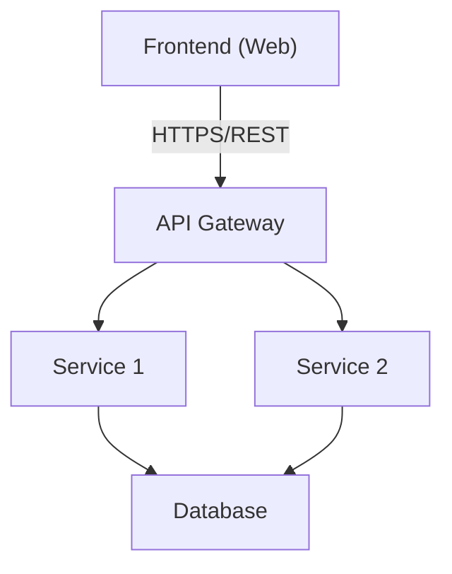
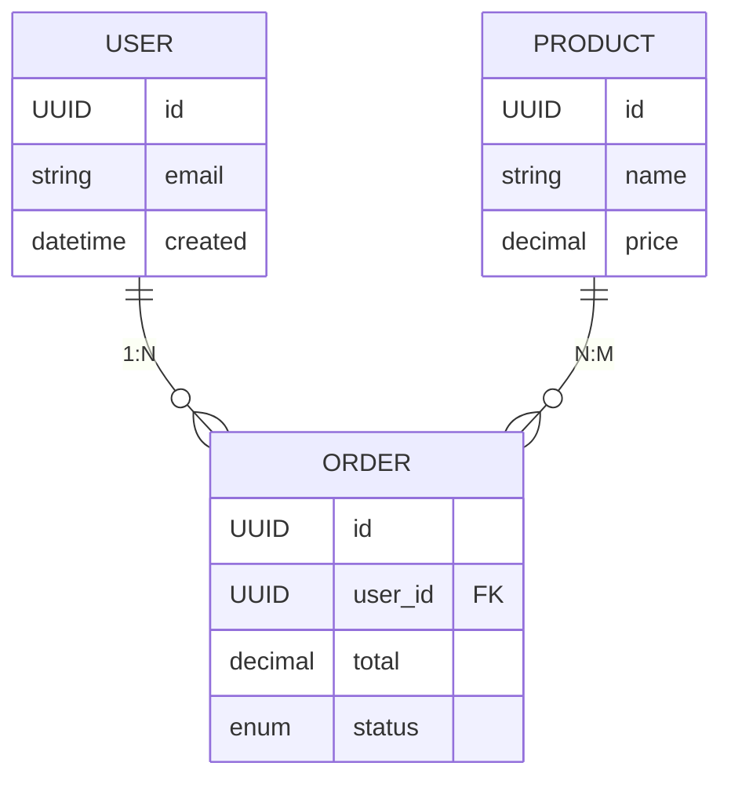
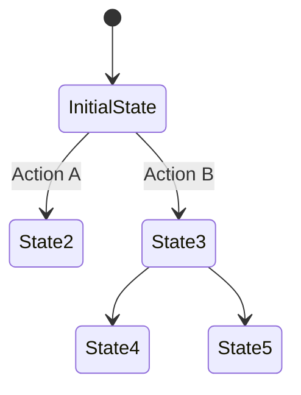

## Executive Summary

**Component**: [Name of system, feature, or component being designed]

**Purpose**: [One-sentence description of what this design achieves]

**Business Value**:

- [Primary business outcome or benefit]
- [User impact or operational improvement]
- [Strategic alignment]

**Key Decisions**:

- [Critical decision 1]
- [Critical decision 2]
- [Critical decision 3]

**Estimated Scope**: [Hours/days of development effort]

---

## Design Goals & Requirements

### Primary Goals

**Functional Goals**:

1. [Goal 1]: [Specific, measurable objective]
2. [Goal 2]: [Specific, measurable objective]
3. [Goal 3]: [Specific, measurable objective]

**Non-Functional Goals**:

- **Performance** [TST]: [Response time, throughput, latency targets]
- **Scalability**: [Concurrent users, data volume, growth projections]
- **Reliability**: [Uptime targets, fault tolerance, disaster recovery]
- **Security** [SFT]: [Authentication, authorisation, data protection requirements]
- **Maintainability** [CA]: [Code quality, documentation, testability standards]
- **Usability**: [User experience, accessibility, internationalisation]

### Success Criteria

**Measurable Outcomes**:

- [ ] [Criterion 1]: [Specific metric and target value]
- [ ] [Criterion 2]: [Specific metric and target value]
- [ ] [Criterion 3]: [Specific metric and target value]

**Acceptance Criteria**:

- [ ] [Feature acceptance criterion 1]
- [ ] [Feature acceptance criterion 2]
- [ ] [Feature acceptance criterion 3]

### Constraints & Assumptions

**Technical Constraints**:

- [Existing infrastructure limitations]
- [Technology stack restrictions]
- [Performance or resource constraints]
- [Integration requirements with legacy systems]

**Business Constraints**:

- [Timeline or deadline constraints]
- [Budget or resource limitations]
- [Regulatory or compliance requirements]
- [Organisational policies or standards]

**Assumptions**:

1. [Assumption about environment, data, or users]
2. [Assumption about dependencies or integrations]
3. [Assumption about team capabilities or tools]

**Risks**:

- [Risk 1]: [Probability/Impact] - [Mitigation strategy]
- [Risk 2]: [Probability/Impact] - [Mitigation strategy]

---

## System Context & Architecture

### Current State

**Existing System Overview**:

- [Brief description of current architecture relevant to this design]
- [Key components and their interactions]
- [Pain points or limitations being addressed]

**Components Affected**: | Component | Change Type | Impact Level |
|-----------|-------------|--------------| | [Component 1] | Modify / New / Delete | High / Medium /
Low | | [Component 2] | Modify / New / Delete | High / Medium / Low |

### System Architecture Diagram



**Diagram Files**:

- High-level architecture: `docs-copper/architecture/diagrams/TDD-NNN-architecture.png`
- Component diagram: `docs-copper/architecture/diagrams/TDD-NNN-components.png`
- Sequence diagram: `docs-copper/architecture/diagrams/TDD-NNN-sequence.png`

### Integration Points

**Internal Integrations**: | Component | Integration Type | Protocol | Data Format |
|-----------|------------------|----------|-------------| | [Service/Module] | Sync/Async/Event |
REST/gRPC/Message Queue | JSON/Protobuf/XML |

**External Integrations**: | External System | Purpose | Protocol | SLA | Error Handling |
|-----------------|---------|----------|-----|----------------| | [Third-party API] | [Purpose] |
REST/SOAP | XX% uptime | Retry/Fallback/Circuit Breaker |

---

## Detailed Design

### Component Overview

**Component Structure**:

```
component-name/
├── controllers/        # API endpoints and request handling
├── services/           # Business logic and orchestration
├── repositories/       # Data access layer
├── models/             # Data models and entities
├── utils/              # Shared utilities and helpers
├── middleware/         # Cross-cutting concerns (auth, logging, etc.)
├── config/             # Configuration management
└── tests/              # Unit, integration, and e2e tests
```

**Responsibilities**:

- **Controllers**: [Responsibility and scope]
- **Services**: [Responsibility and scope]
- **Repositories**: [Responsibility and scope]
- **Models**: [Responsibility and scope]

### Data Model

**Entity Relationship Diagram**:



**Database Schema**:

**Table: `[table_name]`** | Column | Type | Constraints | Description |
|--------|------|-------------|-------------| | id | UUID | PK, NOT NULL | Unique user identifier |
| email | VARCHAR(255) | UNIQUE, NOT NULL | User email address | | created_at | TIMESTAMP | NOT NULL
| Record creation timestamp | | updated_at | TIMESTAMP | NOT NULL | Last update timestamp |

**Indexes**:

- `[index_name_1]`: ON [table_name]([column_name]) - [purpose]
- `[index_name_2]`: ON [table_name]([column_name]) - [purpose]

**Database Migrations**:

- Migration artefact: `[path/to/migration/file]`
- Rollback strategy: [Description of rollback approach]

### API Design

**Endpoints**:

#### Create User

```http
POST /api/v1/users
Content-Type: application/json

{
  "email": "user@example.com",
  "password": "hashed_password",
  "profile": {
    "firstName": "John",
    "lastName": "Doe"
  }
}
```

**Response (201 Created)**:

```json
{
  "id": "550e8400-e29b-41d4-a716-446655440000",
  "email": "user@example.com",
  "profile": {
    "firstName": "John",
    "lastName": "Doe"
  },
  "createdAt": "2025-10-26T14:30:00Z"
}
```

**Error Responses**:

- `400 Bad Request`: Invalid input data (validation errors)
- `409 Conflict`: Email already exists
- `500 Internal Server Error`: Server-side error

#### Additional Endpoints

[Document all other API endpoints following the same pattern]

**API Documentation**:

- OpenAPI Spec: `docs-copper/architecture/apis/openapi/TDD-NNN-api-spec.yaml`
- Postman Collection: `docs-copper/architecture/apis/postman/TDD-NNN-collection.json`

### Business Logic & Algorithms

**Core Algorithms**:

**Algorithm 1: [Name]**

```
Input: [Input parameters]
Output: [Output values]

Steps:
1. [Step 1 with explanation]
2. [Step 2 with explanation]
3. [Step 3 with explanation]

Complexity: O(n log n) time, O(n) space
Edge Cases: [List edge cases and how handled]
```

**Business Rules**:

1. **Rule**: [Business rule statement]

   - **Validation**: [How enforced]
   - **Error Handling**: [What happens on violation]

2. **Rule**: [Business rule statement]
   - **Validation**: [How enforced]
   - **Error Handling**: [What happens on violation]

### State Management

**State Transitions**:



**State Machine**:

- **States**: [List all possible states]
- **Transitions**: [List valid state transitions]
- **Events**: [Events that trigger transitions]
- **Guards**: [Conditions that must be met for transitions]

---

## Alternative Approaches Considered

### Option 1: [Approach Name]

**Description**: [Brief description of this alternative approach]

**Pros**:

- [Benefit 1] **[PRINCIPLE CODE]**
- [Benefit 2] **[PRINCIPLE CODE]**
- [Benefit 3]

**Cons**:

- [Drawback 1] **[PRINCIPLE CODE]**
- [Drawback 2]
- [Drawback 3]

**Why Not Chosen**: [Rationale for rejection]

### Option 2: [Approach Name]

**Description**: [Brief description of this alternative approach]

**Pros**:

- [Benefit 1] **[PRINCIPLE CODE]**
- [Benefit 2]

**Cons**:

- [Drawback 1] **[PRINCIPLE CODE]**
- [Drawback 2]

**Why Not Chosen**: [Rationale for rejection]

### Chosen Approach: [Selected Design]

**Rationale**: [Detailed explanation of why this approach was selected]

**Trade-offs Accepted**:

- [Trade-off 1 and justification]
- [Trade-off 2 and justification]

**Alignment with Principles**:

- **[SF]** Simplicity First: [How design maintains simplicity]
- **[CA]** Clean Architecture: [How design separates concerns]
- **[MOD]** Modularity: [How design enables modular components]

---

## Security Design

### Threat Model

**Assets to Protect**:

- [Asset 1]: [Sensitivity level and importance]
- [Asset 2]: [Sensitivity level and importance]

**Threat Actors**:

- [Threat actor 1]: [Capabilities and motivations]
- [Threat actor 2]: [Capabilities and motivations]

**Attack Vectors**: | Threat | Likelihood | Impact | Mitigation |
|--------|------------|--------|------------| | [SQL Injection] | Medium | High | Parameterised
queries, input validation **[IV]** | | [XSS] | Medium | High | Output encoding, CSP headers
**[SFT]** | | [CSRF] | Low | Medium | CSRF tokens, SameSite cookies **[SFT]** |

### Security Controls

**Authentication & Authorisation**:

- **Authentication Method**: [JWT / OAuth2 / Session-based]
- **Password Storage**: [Bcrypt / Argon2 hashing]
- **Session Management**: [Token expiration, refresh tokens]
- **Authorisation Model**: [RBAC / ABAC / ACL]
- **Row-Level Security**: [Enabled/Disabled] **[RLS]**

**Data Protection**:

- **Encryption at Rest**: [Algorithm and key management]
- **Encryption in Transit**: [TLS 1.3, certificate management]
- **Sensitive Data Handling**: [PII masking, redaction in logs]
- **Data Retention**: [Retention period and deletion strategy]

**Input Validation** [IV]:

- All user inputs validated against whitelist patterns
- Schema validation for API requests (JSON Schema / OpenAPI)
- SQL injection prevention (parameterised queries, ORM)
- XSS prevention (output encoding, sanitisation)

**Rate Limiting & DDoS Protection** [RL]:

- API rate limits: [XX requests per minute per user/IP]
- Circuit breaker for external dependencies
- Request throttling for resource-intensive operations

**Audit & Logging**:

- Security events logged (login, authorisation failures, data access)
- Log retention: [Period] for compliance
- SIEM integration: [Yes/No]

---

## Performance Design

### Performance Requirements

**Response Time Targets**:

- API endpoints: ≤ 200ms (p95)
- Database queries: ≤ 50ms (p95)
- Page load: ≤ 3s (p95)

**Throughput Targets**:

- Concurrent users: [Number of users]
- Requests per second: [target req/s]
- Data volume: [GB/TB of data]

**Resource Limits**:

- CPU: [Usage target]
- Memory: [RAM allocation]
- Database connections: [Max pool size]
- Network bandwidth: [MB/s]

### Performance Optimisation Strategies

**Database Optimisation**:

- Indexing strategy: [List critical indexes]
- Query optimisation: [Query patterns, N+1 prevention]
- Connection pooling: [Pool size and configuration]
- Caching strategy: [Redis, in-memory cache]
- Read replicas: [For read-heavy workloads]

**Application Optimisation**:

- Caching layers: [Application, database query, CDN]
- Lazy loading: [For expensive resources]
- Batch processing: [For bulk operations]
- Asynchronous processing: [For long-running tasks]

**Caching Strategy**: | Cache Layer | Technology | TTL | Invalidation Strategy |
|-------------|------------|-----|----------------------| | Application | In-memory | 5 min |
Time-based + Event-based | | Database queries | Redis | 15 min | Event-based | | Static assets | CDN
| 7 days | Version-based |

**Scaling Strategy**:

- **Horizontal Scaling**: [Stateless services, load balancing]
- **Vertical Scaling**: [Database, specific bottleneck services]
- **Auto-scaling Rules**: [CPU > 70%, requests > XXX/s]

### Load Testing Plan

**Test Scenarios**:

1. **Normal Load**: [XX concurrent users, YY req/s]
2. **Peak Load**: [2× normal load]
3. **Stress Test**: [10× normal load to find breaking point]
4. **Soak Test**: [Normal load for 24+ hours]

**Performance Monitoring**:

- Application metrics: Response time, error rate, throughput
- Infrastructure metrics: CPU, memory, disk I/O, network
- Database metrics: Query time, connection pool, deadlocks
- User experience metrics: Page load time, Time to Interactive (TTI)

---

## Resilience & Error Handling

### Error Handling Strategy

**Error Categories**:

1. **Validation Errors** (4xx): User input errors, client-side issues
2. **Server Errors** (5xx): Internal failures, database errors
3. **Integration Errors**: Third-party API failures, timeouts
4. **Business Logic Errors**: Constraint violations, state errors

**Error Response Format** (consistent across all APIs):

```json
{
  "error": {
    "code": "VALIDATION_ERROR",
    "message": "User-friendly error message",
    "details": [
      {
        "field": "email",
        "issue": "Invalid email format"
      }
    ],
    "requestId": "550e8400-e29b-41d4-a716-446655440000",
    "timestamp": "2025-10-26T14:30:00Z"
  }
}
```

**Error Logging** [REH]:

- All errors logged with context (request ID, user ID, stack trace)
- Sensitive data redacted from logs
- Error aggregation and alerting (Sentry, Datadog)

### Resilience Patterns

**Circuit Breaker**:

- External API calls protected with circuit breaker pattern
- Thresholds: [XX% error rate, YY failures in ZZ seconds]
- Fallback behaviour: [Return cached data, degraded mode, error response]

**Retry Logic**:

- Transient failures: Exponential backoff (1s, 2s, 4s, 8s)
- Idempotency: All retried operations are idempotent
- Max retries: [3-5 attempts before failing]

**Timeouts**:

- API calls: [3-5 seconds]
- Database queries: [1-2 seconds]
- External integrations: [10-30 seconds]

**Graceful Degradation**:

- Critical features continue working when non-critical features fail
- Fallback to read-only mode if write operations fail
- Cached data served when fresh data unavailable

### Disaster Recovery

**Backup Strategy**:

- Database backups: [Daily full, hourly incremental]
- Backup retention: [30 days]
- Backup testing: [Monthly restore verification]

**Recovery Time Objectives (RTO/RPO)**:

- RTO (Recovery Time Objective): [4 hours]
- RPO (Recovery Point Objective): [1 hour]

**Failover Plan**:

1. Detect failure: [Monitoring alerts, health checks]
2. Initiate failover: [Automated / Manual]
3. Switch traffic: [Load balancer, DNS update]
4. Verify recovery: [Health checks, smoke tests]
5. Post-mortem: [Root cause analysis, improvements]

---

## Testing Strategy

### Unit Testing

**Components to Test**:

- Services: Business logic, validation, error handling
- Repositories: Data access, query construction
- Utilities: Helper functions, data transformations

**Coverage Targets**:

- Overall: ≥ 80% **[TST]**
- Critical paths: 100%
- Edge cases: Explicitly tested

**Testing Framework**:

- Language: [Jest / Pytest / JUnit / etc.]
- Mocking: [Framework for mocking dependencies]
- Test data: [Factories, fixtures]

**Example Test Case**:

```typescript
describe('UserService', () => {
  describe('createUser', () => {
    it('should create user with valid data', async () => {
      // Arrange
      const userData = { email: 'test@example.com', password: 'secure123' };

      // Act
      const result = await userService.createUser(userData);

      // Assert
      expect(result.email).toBe('test@example.com');
      expect(result.id).toBeDefined();
    });

    it('should throw error for duplicate email', async () => {
      // Test duplicate email scenario
    });
  });
});
```

### Integration Testing

**Integration Test Scenarios**:

1. **API Integration**: End-to-end API request/response flows
2. **Database Integration**: Repository tests against real database
3. **External Service Integration**: Third-party API integration tests
4. **Message Queue Integration**: Event publishing and consumption

**Test Environment**:

- Database: [Docker container, test database instance]
- External services: [Mocked, sandboxed APIs]
- Message queue: [In-memory broker, test instance]

**Critical Flows to Test**:

- [ ] User registration and login flow
- [ ] Core business operation (e.g., order creation)
- [ ] Error handling and recovery flows
- [ ] Data consistency across services

### End-to-End Testing

**E2E Test Scenarios**:

1. **Happy Path**: Complete user workflow from start to finish
2. **Error Path**: User encounters errors and recovers
3. **Edge Cases**: Boundary conditions, unusual inputs
4. **Cross-Browser**: Functionality across browsers (if applicable)

**E2E Testing Tools**:

- Framework: [Playwright / Cypress / Selenium]
- CI Integration: [Run on every PR, nightly builds]
- Visual regression: [Percy, BackstopJS]

### Performance Testing

**Load Testing**:

- Tool: [Apache JMeter, k6, Gatling]
- Scenarios: Normal load, peak load, stress test
- Metrics: Response time (p50, p95, p99), throughput, error rate

**Benchmarking**:

- Critical endpoints benchmarked before and after changes
- Performance regression detection automated in CI/CD

---

## Deployment Strategy

### Deployment Architecture

**Environments**:

1. **Development**: [Local, Docker Compose]
2. **Testing/Staging**: [Cloud-based, mirrors production]
3. **Production**: [Multi-region, high availability]

**Infrastructure as Code**:

- Tool: [Terraform / CloudFormation / Pulumi]
- Repository: `/infrastructure/terraform/TDD-NNN/`
- State management: [Remote backend, locking]

### Deployment Process

**Deployment Pipeline**:

```
Code Push → Build → Unit Tests → Integration Tests → Security Scan
    → Deploy to Staging → E2E Tests → Manual Approval → Deploy to Production
    → Smoke Tests → Monitor
```

**Deployment Checklist**:

- [ ] All tests passing (unit, integration, e2e)
- [ ] Security scan completed (no critical vulnerabilities)
- [ ] Performance benchmarks met
- [ ] Database migrations tested on staging
- [ ] Rollback plan documented and tested
- [ ] Monitoring and alerts configured
- [ ] Documentation updated (API docs, runbooks)
- [ ] Stakeholders notified of deployment window

**Rollback Strategy**:

- **Trigger**: [Monitoring alerts, error spike, manual decision]
- **Process**: [Load balancer switch, revert deployment, database rollback if needed]
- **Validation**: [Health checks, smoke tests, error rate monitoring]

### Feature Flags

**Feature Toggle Strategy**:

- New features behind feature flags for gradual rollout
- Flags managed via [LaunchDarkly / Unleash / Custom]
- Rollout stages: Internal → Beta users → 10% → 50% → 100%

**Kill Switches**:

- Critical features have kill switches for emergency shutdown
- Kill switch locations: [List critical components]

---

## Monitoring & Observability

### Metrics

**Application Metrics**:

- Request rate (requests per second)
- Error rate (errors per second, % of requests)
- Response time (p50, p95, p99)
- Active users/sessions

**Business Metrics**:

- [Business KPI 1]: [Target value]
- [Business KPI 2]: [Target value]
- [Conversion rate / Transaction volume / etc.]

**Infrastructure Metrics**:

- CPU utilisation (%)
- Memory utilisation (%)
- Disk I/O (MB/s)
- Network throughput (MB/s)
- Database connection pool usage

### Logging

**Logging Strategy**:

- **Structured Logging**: JSON format with consistent fields
- **Log Levels**: DEBUG, INFO, WARN, ERROR, FATAL
- **Correlation IDs**: Request tracing across services
- **Sensitive Data**: Redacted from logs (passwords, tokens, PII)

**Log Aggregation**:

- Tool: [ELK Stack / Splunk / Datadog / CloudWatch]
- Retention: [30 days standard, 90 days for audit logs]
- Search and analysis: [Kibana / Datadog UI]

**Example Log Entry**:

```json
{
  "timestamp": "2025-10-26T14:30:00Z",
  "level": "INFO",
  "service": "user-service",
  "requestId": "550e8400-e29b-41d4-a716-446655440000",
  "userId": "user-123",
  "message": "User created successfully",
  "details": {
    "email": "user@example.com"
  }
}
```

### Tracing

**Distributed Tracing**:

- Tool: [Jaeger / Zipkin / OpenTelemetry]
- Trace critical user journeys across services
- Identify bottlenecks and latency issues

### Alerting

**Alert Configuration**: | Metric | Threshold | Severity | Action |
|--------|-----------|----------|--------| | Error rate | > 5% | Critical | Page on-call engineer |
| Response time p95 | > 500ms | Warning | Notify team channel | | CPU usage | > 80% | Warning |
Auto-scale if enabled | | Disk space | < 20% free | Critical | Expand storage |

**On-Call Procedures**:

- Runbook location: `[path/to/runbook/TDD-NNN-troubleshooting.md]`
- Escalation path: [Engineer → Team Lead → Manager]
- Incident response: [Document incidents, post-mortems]

---

## Documentation & Knowledge Transfer

### Documentation Deliverables

**Technical Documentation**:

- [ ] Architecture diagrams (high-level, component, sequence)
- [ ] API documentation (OpenAPI spec, examples)
- [ ] Database schema documentation (ERD, table definitions)
- [ ] Deployment runbook (step-by-step deployment guide)
- [ ] Troubleshooting guide (common issues, solutions)
- [ ] Monitoring dashboard (metrics, alerts configuration)

**Code Documentation**:

- [ ] Inline code comments for complex logic
- [ ] README.md in component directory
- [ ] ADR created for major technical decisions
- [ ] Dev journal entry documenting implementation

**User-Facing Documentation**:

- [ ] API consumer guide (authentication, endpoints, examples)
- [ ] Integration guide (how to integrate with this component)
- [ ] Migration guide (if replacing existing system)

### Knowledge Transfer Plan

**Team Onboarding**:

1. Overview session: Architecture walkthrough (1 hour)
2. Code walkthrough: Key components and patterns (2 hours)
3. Hands-on session: Deploy to local environment (1 hour)
4. Q&A session: Team questions and clarifications (30 min)

**Documentation Location**:

- Architecture diagrams: `docs-copper/architecture/diagrams/`
- API docs: `docs-copper/architecture/apis/`
- Runbooks: `[path/to/runbooks/]`
- ADR: `docs-copper/architecture/adr/`

---

## Timeline & Milestones

### Implementation Phases

**Phase 1: Foundation** ([X weeks])

- [ ] Database schema design and migration
- [ ] Core data models and repositories
- [ ] Basic API endpoints (CRUD operations)
- [ ] Unit tests for core components

**Phase 2: Business Logic** ([X weeks])

- [ ] Business rules implementation
- [ ] Service layer development
- [ ] Integration with external services
- [ ] Integration tests

**Phase 3: Security & Performance** ([X weeks])

- [ ] Authentication and authorisation
- [ ] Input validation and sanitisation
- [ ] Performance optimisation (caching, indexing)
- [ ] Security testing and hardening

**Phase 4: Testing & Deployment** ([X weeks])

- [ ] E2E test suite development
- [ ] Load testing and performance benchmarking
- [ ] Staging deployment and validation
- [ ] Production deployment preparation

**Phase 5: Monitoring & Documentation** ([X weeks])

- [ ] Monitoring dashboards and alerts
- [ ] Comprehensive documentation
- [ ] Runbooks and troubleshooting guides
- [ ] Team training and knowledge transfer

### Key Milestones

| Milestone              | Target Date | Dependencies           | Success Criteria           |
| ---------------------- | ----------- | ---------------------- | -------------------------- |
| Design Review Approved | YYYY-MM-DD  | This document complete | Stakeholder sign-off       |
| Phase 1 Complete       | YYYY-MM-DD  | Design approval        | Core functionality working |
| Phase 2 Complete       | YYYY-MM-DD  | Phase 1                | Business logic tested      |
| UAT Sign-off           | YYYY-MM-DD  | Phase 3                | Acceptance criteria met    |
| Production Deployment  | YYYY-MM-DD  | All phases             | Live with monitoring       |

---

## Stakeholder Sign-off

### Review & Approval

**Reviewers**: | Name | Role | Review Focus | Status | Date |
|------|------|--------------|--------|------| | [Name] | Tech Lead | Architecture, scalability |
Pending | | | [Name] | Security Engineer | Security controls, threat model | Pending | | | [Name] |
Product Owner | Business requirements, UX | Pending | | | [Name] | DevOps Engineer | Deployment,
monitoring | Pending | |

**Approval Criteria**:

- [ ] Architecture aligns with enterprise standards **[ARC]**
- [ ] Security requirements met **[SFT]**
- [ ] Performance targets achievable
- [ ] Deployment strategy feasible
- [ ] Documentation comprehensive **[SD]**

**Decision**:

- [ ] **Approved** - Proceed with implementation
- [ ] **Approved with Conditions** - [List conditions]
- [ ] **Revisions Required** - [List required changes]
- [ ] **Rejected** - [Provide rationale]

**Approval Signature**:

- **Approver**: [Name, Role]
- **Date**: YYYY-MM-DD
- **Comments**: [Optional feedback or conditions]

---

## Appendices

### Appendix A: Glossary

| Term     | Definition   |
| -------- | ------------ |
| [Term 1] | [Definition] |
| [Term 2] | [Definition] |

### Appendix B: References

**Internal References**:

- [ADR-XXX](../architecture/adr/ADR-XXX-name.md): Related architectural decision
- [US-XXX](../roadmap/backlog/US-XXX-name.md): Related user story
- [Memory Bank](../memory-bank/techContext.md): Technology context

**External References**:

- [Link to relevant documentation, standards, or frameworks]
- [Link to technology documentation]
- [Link to industry best practices]

---

**Design Status**: [draft | in-review | approved | implemented | archived] **Last Updated**:
YYYY-MM-DD

---

> [!tip]- TEMPLATE USAGE GUIDELINES **To be excluded from the generated technical design document.**
>
> **INSTRUCTIONS FOR COMPLETING THIS TEMPLATE**:
>
> 1. Create design document at: `docs-copper/architecture/technical-designs/TDD-NNN-name.md`
> 2. Naming convention: `TDD-NNN-kebab-case-name.md`
> 3. Replace all [placeholder text] with actual content
> 4. Update YAML frontmatter with real values
> 5. Create accompanying diagrams in `docs-copper/architecture/diagrams/`
> 6. Remove sections not applicable to your design
> 7. Tag all design decisions with appropriate principle codes
> 8. Link to related ADRs, user stories, and memory bank entries
> 9. Delete this entire callout section before finalising
>
> **WHEN TO CREATE A TECHNICAL DESIGN DOCUMENT**:
>
> - Before implementing significant new features or components
> - When architectural decisions need peer review
> - For complex integrations or system changes
> - When multiple approaches need evaluation
> - Before refactoring major components
> - For system-wide performance or security improvements
>
> **DESIGN REVIEW PROCESS**:
>
> **Before Writing**:
>
> 1. Understand requirements (review user stories, business needs)
> 2. Research existing patterns and standards
> 3. Identify stakeholders who need to review
> 4. Gather relevant ADRs and architectural context
>
> **During Writing**:
>
> 1. Start with Executive Summary (high-level overview)
> 2. Document current state before proposing new design
> 3. Consider multiple approaches (document alternatives)
> 4. Include diagrams (architecture, sequence, component)
> 5. Address non-functional requirements explicitly
> 6. Document trade-offs and assumptions clearly
>
> **Review & Approval**:
>
> 1. Share with technical reviewers (architects, tech leads)
> 2. Present to stakeholders (product, security, ops)
> 3. Incorporate feedback and update document
> 4. Obtain formal approval before implementation
> 5. Create ADRs for major decisions from this design
>
> **After Approval**:
>
> 1. Update memory bank with design decisions
> 2. Create implementation tasks (breakdown into subtasks)
> 3. Use design as reference during development
> 4. Update design if significant deviations occur
> 5. Archive when implementation complete
>
> **FRONTMATTER FIELD GUIDANCE**:
>
> - `design_id`: Format `TDD-NNN` (sequential numbering)
> - `title`: Descriptive title of the design
> - `component_name`: Name of component/system being designed
> - `design_type`: feature | refactoring | integration | infrastructure | security
> - `status`: draft | in-review | approved | implemented | archived
> - `author`: Primary designer/architect
> - `reviewers`: Array of reviewer names
> - `created`: YYYY-MM-DD (creation date)
> - `last_modified`: YYYY-MM-DD (last update date)
> - `related_story`: Link to related user story (if applicable)
> - `related_adr`: Link to related ADR (if applicable)
> - `priority`: low | medium | high | critical
> - `complexity`: simple | moderate | complex | highly-complex
> - `estimated_effort`: Development time estimate (hours/days/weeks)
> - `tags`: Array of relevant tags (e.g., [backend, security, performance])
>
> **DIAGRAM CREATION**:
>
> - Create diagrams using: Draw.io, Lucidchart, PlantUML, Mermaid
> - Store diagrams in: `docs-copper/architecture/diagrams/`
> - Naming convention: `TDD-NNN-{architecture|component|sequence|erd}.{png|svg}`
> - Include both source files (.drawio, .puml) and exported images
> - Reference diagram files in document with relative paths
>
> **COMMON DIAGRAM TYPES**:
>
> - **Architecture Diagram**: High-level system architecture, components, data flow
> - **Component Diagram**: Internal structure of a component, classes, modules
> - **Sequence Diagram**: Interaction between components over time
> - **ERD (Entity Relationship Diagram)**: Database schema, relationships
> - **Deployment Diagram**: Infrastructure, servers, containers, networks
>
> **INTEGRATION WITH OTHER ARTEFACTS**:
>
> - **User Stories**: Link to related user stories that require this design
> - **ADRs**: Create ADRs for significant architectural decisions
> - **Memory Bank**: Update `techContext.md` with new technology choices
> - **API Docs**: Reference or create OpenAPI specs for API designs
> - **Dev Journal**: Document design evolution in dev journal entries
>
> **DESIGN BEST PRACTICES**:
>
> - **Precision**: Be specific, avoid vague statements ("fast" → "< 200ms p95")
> - **Completeness**: Cover all aspects (functional, security, performance, monitoring)
> - **Long-term Thinking**: Consider maintainability and 3-5 year horizon **[CA]**
> - **Quality First**: Don't compromise on quality for speed
> - **Documentation**: Comprehensive documentation is expected, not optional **[SD]**
>
> **PRINCIPLE CODE USAGE**: Tag design decisions with relevant principle codes to show alignment:
>
> - **[SF]** Simplicity First: Simple, straightforward solutions
> - **[CA]** Clean Architecture: Separation of concerns, modularity
> - **[MOD]** Modularity: Loosely coupled, reusable components
> - **[DM]** Dependency Minimalism: Minimal external dependencies
> - **[TST]** Test Coverage: Testability considerations
> - **[SFT]** Security First: Security by design
> - **[REH]** Robust Error Handling: Comprehensive error handling
> - **[ARC]** Architecture Stability: Decisions that support long-term stability
>
> **COMMON PITFALLS TO AVOID**:
>
> 1. **Vague Requirements**: Quantify all targets (response time, throughput, etc.)
> 2. **Missing Alternatives**: Always document at least 2 alternatives considered
> 3. **No Diagrams**: Visual representations are essential for clarity
> 4. **Ignoring Non-Functionals**: Security, performance, scalability must be addressed
> 5. **Weak Error Handling**: Error scenarios often neglected - document thoroughly
> 6. **No Monitoring Plan**: Observability should be designed upfront, not retrofitted
> 7. **Missing Rollback Strategy**: Always plan for deployment failures
> 8. **Inadequate Testing Strategy**: Testing approach should be detailed, not vague
>
> **QUALITY CHECKLIST**: Before submitting for review:
>
> - [ ] Executive summary clearly states problem and solution
> - [ ] All design goals have measurable success criteria
> - [ ] At least 2 alternative approaches documented with pros/cons
> - [ ] Architecture diagrams included (high-level, component, sequence)
> - [ ] Database schema defined with tables, indexes, migrations
> - [ ] API endpoints documented with request/response examples
> - [ ] Security controls explicitly defined (auth, data protection, validation)
> - [ ] Performance targets specified with optimisation strategies
> - [ ] Error handling strategy comprehensive (all error types covered)
> - [ ] Testing strategy detailed (unit, integration, e2e, load tests)
> - [ ] Deployment strategy includes rollback plan
> - [ ] Monitoring and alerting configuration specified
> - [ ] Documentation deliverables listed
> - [ ] Stakeholder reviewers identified
> - [ ] Principle codes tagged throughout document
> - [ ] Related ADRs, user stories, memory bank updated

> [!info]- TEMPLATE DATA (YAML BackMatter) For indexing, search, and validation purposes. **To be
> excluded from the generated technical design document.**
>
> ```yaml
> template_name: 'Technical Design Document Template'
> template_description:
>   'Comprehensive template for documenting technical designs before implementation, covering
>   architecture, security, performance, testing, and deployment'
> template_scope:
>   'Use for significant features, system changes, integrations, and architectural decisions
>   requiring peer review and stakeholder approval'
> template_version: '1.0.0'
> template_last_updated: '2025-10-26'
> template_status: 'active'
> template_category: 'design'
> template_maintained_by: '[Project Team]'
>
> principle_codes_emphasized:
>   - SF # Simplicity First
>   - CA # Clean Architecture
>   - MOD # Modularity Focus
>   - ARC # Architecture Stability
>   - SFT # Security-First Thinking
>   - TST # Test Coverage
>   - REH # Robust Error Handling
>   - SD # Strategic Documentation
>   - DM # Dependency Minimalism
>   - ISA # Industry Standards Adherence
>   - ORG # Organisational Clarity
>   - IMP # Impact Analysis
>
> cross_references:
>   - 'User Story Template: user-story-template.md'
>   - 'ADR Template: adr-template.md'
>   - 'Sprint Planning Template: sprint-planning-template.md'
>   - 'Dev Journal Template: dev-journal-template.md'
>   - 'API Endpoint Template: (to be created)'
>   - 'Memory Bank: docs-copper/memory-bank/'
>   - 'Architecture Diagrams: docs-copper/architecture/diagrams/'
>   - 'ADR Directory: docs-copper/architecture/adr/'
>
> applies_to:
>   - 'Software architects designing new systems or components'
>   - 'Senior engineers proposing complex technical solutions'
>   - 'Technical leads evaluating architectural alternatives'
>   - 'Product owners understanding technical approach'
>   - 'Security engineers reviewing security design'
>   - 'DevOps engineers planning deployment strategy'
>
> usage_pattern:
>   when_to_create:
>     - 'Before implementing significant new features (>5 story points)'
>     - 'When architectural decisions need peer review and stakeholder approval'
>     - 'For complex integrations with external systems'
>     - 'Before major refactoring or system changes'
>     - 'When multiple technical approaches need evaluation'
>     - 'For system-wide performance or security improvements'
>   naming_convention:
>     pattern: 'TDD-NNN-kebab-case-name.md'
>     examples: 'TDD-001-user-authentication.md, TDD-002-payment-gateway-integration.md'
>   storage_location: 'docs-copper/architecture/technical-designs/'
>
> related_workflows:
>   - 'Review user stories to understand requirements before designing'
>   - 'Create architecture diagrams in docs-copper/architecture/diagrams/'
>   - 'Document major decisions as ADRs after design approval'
>   - 'Update memory-bank/project-context/techContext.md with technology choices'
>   - 'Link from user stories to provide technical implementation context'
>   - 'Reference in dev journal entries during implementation'
>   - 'Use as foundation for API documentation (OpenAPI specs)'
>
> design_review_process:
>   stages:
>     - 'Draft: Initial design, gathering feedback'
>     - 'In Review: Formal review with stakeholders'
>     - 'Approved: Ready for implementation'
>     - 'Implemented: Design realised in code'
>     - 'Archived: Superseded or no longer relevant'
>   reviewers:
>     - 'Tech Lead: Architecture and design patterns'
>     - 'Security Engineer: Security controls and threat model'
>     - 'Product Owner: Business requirements alignment'
>     - 'DevOps Engineer: Deployment and operations feasibility'
>     - 'Performance Engineer: Scalability and performance (for critical systems)'
>
> swiss_quality_emphasis:
>   - 'Precision in requirements (quantified, measurable targets)'
>   - 'Comprehensive coverage (functional + non-functional requirements)'
>   - 'Long-term thinking (maintainability, 3-5 year horizon)'
>   - 'Quality over speed (thorough design before implementation)'
>   - 'Documentation completeness (diagrams, API specs, runbooks)'
>   - 'Risk mitigation (thorough threat model, error handling, rollback)'
>
> common_design_patterns:
>   - 'Microservices: Service decomposition, API gateway, event-driven'
>   - 'Layered Architecture: Presentation, business logic, data access'
>   - 'Event Sourcing: Event log, projections, eventual consistency'
>   - 'CQRS: Command-query separation, read/write models'
>   - 'Repository Pattern: Data access abstraction'
>   - 'Factory Pattern: Object creation abstraction'
>   - 'Strategy Pattern: Algorithm selection at runtime'
>   - 'Observer Pattern: Event notification, pub/sub'
>
> external_references:
>   - 'C4 Model: https://c4model.com/ (context, containers, components, code)'
>   - 'Clean Architecture:
>     https://blog.cleancoder.com/uncle-bob/2012/08/13/the-clean-architecture.html'
>   - 'OWASP Threat Modelling: https://owasp.org/www-community/Threat_Modeling'
>   - '12-Factor App: https://12factor.net/'
>   - 'API Design Guide: https://cloud.google.com/apis/design'
>   - 'Database Design: https://www.postgresql.org/docs/current/ddl.html'
> ```
