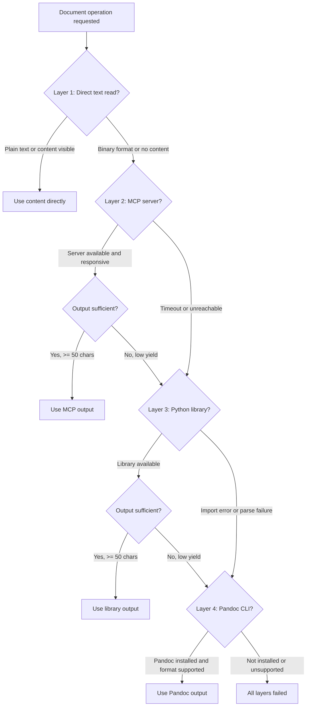

# cu-cascade-handler: Document Processing Cascade Protocol

## Purpose

This skill defines the **cascading-fallback decision protocol** for all document processing
operations in the COPPER framework. When an agent needs to read, write, or generate a document, it
follows this protocol to select the best available handler, falling through to the next layer if the
current one fails or produces insufficient output.

**Architecture Decision**: ADR-017 establishes this protocol as the single source of truth for
cascade semantics across Word, Excel, PowerPoint, and PDF formats.

## Cascade Layers

The protocol defines four layers, attempted in order. Each layer has explicit trigger conditions for
when to proceed to the next layer.

### Layer 1: Direct Text Read

**When**: The file is plain text (`.md`, `.txt`, `.csv`) OR the agent can already see the file
content through its native multimodal capability.

**What**: The agent reads the content directly without invoking any external tool.

**Important**: This layer is NOT an executable code path. It is a documented agent heuristic. The
agent evaluates whether it already has the file content available before invoking any MCP server or
library.

**Fall-through triggers**:

- The file is a binary format (.docx, .xlsx, .pptx, .pdf) that the agent cannot natively parse
- The agent does not have the file content in its context window
- The extracted text is fewer than 50 characters after whitespace stripping (low-yield rule)

### Layer 2: MCP Server

**When**: Layer 1 did not produce usable output AND a format-specific MCP server is configured in
`opencode.jsonc`.

**What**: The agent invokes the appropriate MCP server tool:

| Format             | MCP Server                  | Tools                                                           |
| ------------------ | --------------------------- | --------------------------------------------------------------- |
| Word (.docx)       | `word`                      | `word_get_document_text`, `word_add_paragraph`, etc.            |
| Excel (.xlsx)      | `excel`                     | `excel_read_data_from_excel`, `excel_write_data_to_excel`, etc. |
| PowerPoint (.pptx) | `powerpoint`                | `powerpoint_extract_slide_text`, `powerpoint_add_slide`, etc.   |
| PDF (.pdf)         | `pdf-tools` or `markitdown` | `pdf-tools_read_pdf_content`, `markitdown_convert_to_markdown`  |

**Fall-through triggers**:

- MCP server timeout (request exceeds 30 seconds)
- MCP server unreachable (connection error, server not running)
- Schema mismatch (response does not match expected structure)
- Low-yield result (extracted text fewer than 50 characters after whitespace stripping)

### Layer 3: Python Library

**When**: Layer 2 failed AND a format-specific Python library is available.

**What**: The agent invokes the Python library via the tool runner:

| Format             | Library       | Operations            |
| ------------------ | ------------- | --------------------- |
| Word (.docx)       | `python-docx` | Read, write, generate |
| Excel (.xlsx)      | `openpyxl`    | Read, write           |
| PowerPoint (.pptx) | `python-pptx` | Read, write, generate |
| PDF (.pdf)         | `pypdf`       | Read                  |

**Fall-through triggers**:

- Import error (library not installed)
- File corruption (library cannot parse the file)
- Permission error (file is locked or read-only for write operations)
- Low-yield result (extracted text fewer than 50 characters after whitespace stripping)

### Layer 4: Pandoc CLI

**When**: Layer 3 failed AND Pandoc is installed on the system.

**What**: The agent invokes Pandoc for format conversion:

- **Read**: Convert source format to Markdown (`pandoc input.docx -t markdown`)
- **Write/Generate**: Convert Markdown to target format (`pandoc input.md -o output.docx`)

**Fall-through triggers**:

- Pandoc not installed on the system
- Pandoc returns a non-zero exit code
- Output file is empty or corrupted

**Layer 4 Coverage Limitations**:

| Format             | Read          | Write         | Generate      | Notes                                                           |
| ------------------ | ------------- | ------------- | ------------- | --------------------------------------------------------------- |
| Word (.docx)       | Supported     | Supported     | Supported     | Full Pandoc support                                             |
| Excel (.xlsx)      | Not supported | Not supported | Not supported | Pandoc does not handle spreadsheets                             |
| PowerPoint (.pptx) | Partial       | Not supported | Not supported | Pandoc can extract text from PPTX; cannot write PPTX            |
| PDF (.pdf)         | Supported     | Not supported | Not supported | Pandoc can extract text from PDF; PDF generation requires LaTeX |
| Markdown (.md)     | Not needed    | Not needed    | Not needed    | Native agent capability                                         |

## Decision Protocol

The agent follows this decision tree for every document operation:



## Low-Yield Detection Rule

**Rule**: After whitespace stripping (removing leading/trailing whitespace, newlines, tabs), if the
extracted text is fewer than 50 characters, the result is classified as "low yield" and the agent
falls through to the next layer.

**Rationale**:

- A 50-character threshold catches empty files, password-protected files, and corrupt extractions
- The threshold is uniform across all formats and all layers
- This rule supersedes any format-specific low-yield definitions in individual stories

**Example**:

```python
# Pseudo-code for the low-yield check
extracted_text = layer_output.strip()
if len(extracted_text) < 50:
    # Low yield: fall through to next layer
    emit_telemetry(layer=current_layer, status="low_yield", char_count=len(extracted_text))
    proceed_to_next_layer()
```

## Error-Surfacing Rule

**Rule**: Errors from individual layers are captured and logged via telemetry but only surfaced to
the caller when ALL layers have failed. The final error message lists each layer attempted, the
handler class, and the failure cause.

**Error message format**:

```
Document processing failed for [filename]. All cascade layers exhausted:
- Layer 1 (Direct text read): Not applicable (binary format)
- Layer 2 (MCP server / [server-name]): [error class] - [error message]
- Layer 3 (Python library / [library-name]): [error class] - [error message]
- Layer 4 (Pandoc CLI): [error class] - [error message]
```

**Per-layer error capture**:

Each layer attempt records:

| Field           | Description                                                                                                 |
| --------------- | ----------------------------------------------------------------------------------------------------------- |
| `layer`         | Layer number (1-4)                                                                                          |
| `handler_class` | Specific handler used (e.g., `word MCP server`, `python-docx`, `pandoc`)                                    |
| `status`        | `success`, `low_yield`, `error`, `not_applicable`                                                           |
| `error_class`   | Category: `timeout`, `unreachable`, `import_error`, `parse_error`, `permission_error`, `unsupported_format` |
| `error_message` | Human-readable error description                                                                            |
| `char_count`    | Characters extracted (if any)                                                                               |

## Telemetry Emission Contract

Every layer attempt emits exactly one telemetry record. All records from the same operation share a
`trace_id`.

**Record schema**:

| Field           | Type           | Description                                                            |
| --------------- | -------------- | ---------------------------------------------------------------------- |
| `trace_id`      | string         | Unique identifier for the operation (shared across all layer attempts) |
| `timestamp`     | ISO 8601       | When the layer attempt started                                         |
| `operation`     | enum           | `read`, `write`, `generate`                                            |
| `format`        | enum           | `docx`, `xlsx`, `pptx`, `pdf`, `md`, `txt`, `csv`                      |
| `layer`         | integer        | 1, 2, 3, or 4 (internal debugging view only)                           |
| `handler_class` | string         | Specific handler used (maps to the `handler` category in the sink)     |
| `status`        | enum           | `success`, `low_yield`, `error`, `not_applicable`, `skipped`           |
| `error_class`   | string or null | Error category (null if successful)                                    |
| `char_count`    | integer        | Characters extracted (0 if error) , internal debugging view only       |
| `duration_ms`   | integer        | Time spent on this layer attempt (maps to `latency_ms` in the sink)    |

> **Privacy correction (US-166 AC6)**: the previously documented `filename` field is **removed**.
> The persisted telemetry record MUST NOT carry a filename, content, or extracted-text key. Only
> `file_size_bytes` is permitted as a size/identity signal. See the `cu:telemetry` skill.

**Co-development note**: This table is the cascade handler's richer _internal_ emitter view. The
**canonical, persisted record contract is owned by US-166** (`cu:telemetry`:
`resources/fallback-event.schema.json`). The internal view maps DOWN to that record at emit time
(`handler_class` → `handler`, `duration_ms` → `latency_ms`; `layer`/`char_count` are dropped). Where
the two conflict, the US-166 schema is authoritative , notably the privacy invariant above.

## Worked Examples

### Example 1: Read a Word document (read operation)

**Scenario**: Agent needs to read `proposal-draft.docx` to extract its content.

1. **Layer 1 (Direct text read)**: The file is `.docx` (binary). The agent cannot natively parse it.
   **Result**: Not applicable. Fall through to Layer 2.

2. **Layer 2 (MCP server / `word`)**: Agent calls `word_get_document_text`. The MCP server responds
   with the full document text. After whitespace stripping, the text is 4,200 characters.
   **Result**: Success. Use this output. No further layers needed.

### Example 2: Read a PDF with failing MCP server (read operation)

**Scenario**: Agent needs to read `financial-report.pdf`, but the `pdf-tools` MCP server is not
running.

1. **Layer 1 (Direct text read)**: The file is `.pdf` (binary). **Result**: Not applicable. Fall
   through.

2. **Layer 2 (MCP server / `pdf-tools`)**: Agent calls `pdf-tools_read_pdf_content`. Connection
   refused (server not running). **Result**: Error (`unreachable`). Fall through to Layer 3.

3. **Layer 3 (Python library / `pypdf`)**: Agent invokes `pypdf` via tool runner. The library
   extracts text successfully: 12,500 characters. **Result**: Success. Use this output.

### Example 3: Generate a PowerPoint file (generate operation)

**Scenario**: Agent needs to generate `quarterly-summary.pptx` from structured data.

1. **Layer 1 (Direct text read)**: Not applicable for generate operations. **Result**: Skipped.

2. **Layer 2 (MCP server / `powerpoint`)**: Agent calls `powerpoint_create_presentation` then
   `powerpoint_add_slide` for each slide. The MCP server creates the file successfully. **Result**:
   Success. File created at target path.

### Example 3b: Write to an existing Excel file (write operation)

**Scenario**: Agent needs to write pricing data to an existing `budget-2026.xlsx` spreadsheet.

1. **Layer 1 (Direct text read)**: Not applicable for write operations on binary formats.
   **Result**: Skipped.

2. **Layer 2 (MCP server / `excel`)**: Agent calls `excel_write_data_to_excel` with the target cell
   range and data. The MCP server writes the data successfully and saves the file. **Result**:
   Success. Data written to the spreadsheet.

### Example 4: All layers fail (read operation)

**Scenario**: Agent needs to read `corrupted.xlsx`, but all handlers fail.

1. **Layer 1**: Binary format. Not applicable.

2. **Layer 2 (MCP server / `excel`)**: Agent calls `excel_read_data_from_excel`. Server returns an
   error: "Cannot open file (corrupt header)."

3. **Layer 3 (Python library / `openpyxl`)**: Agent invokes `openpyxl`. Import error: "Worksheet is
   corrupt."

4. **Layer 4 (Pandoc CLI)**: Pandoc does not support Excel. Not applicable.

**Result**: All layers failed. Surface consolidated error:

```
Document processing failed for corrupted.xlsx. All cascade layers exhausted:
- Layer 1 (Direct text read): Not applicable (binary format)
- Layer 2 (MCP server / excel): parse_error - Cannot open file (corrupt header)
- Layer 3 (Python library / openpyxl): parse_error - Worksheet is corrupt
- Layer 4 (Pandoc CLI): Not applicable (Excel not supported by Pandoc)
```

## Format-Specific Handler Lists

Format skills declare which handlers are available for their format. The cascade handler provides
the protocol; format skills provide the handler inventory.

| Format             | Layer 2 Handler                 | Layer 3 Handler | Layer 4 Handler    | Notes                                 |
| ------------------ | ------------------------------- | --------------- | ------------------ | ------------------------------------- |
| Word (.docx)       | `word` MCP server               | `python-docx`   | Pandoc             | Full 4-layer cascade                  |
| Excel (.xlsx)      | `excel` MCP server              | `openpyxl`      | None               | Pandoc does not handle spreadsheets   |
| PowerPoint (.pptx) | `powerpoint` MCP server         | `python-pptx`   | Pandoc (read only) | Layer 4 write/generate not supported  |
| PDF (.pdf)         | `pdf-tools` or `markitdown` MCP | `pypdf`         | Pandoc (read only) | Layer 4 write/generate requires LaTeX |

## Related Documentation

- **ADR-017**: Cascading fallback for document processing (this skill's architectural decision)
- **ADR-009**: Skill architecture and loading model (MECE rule this skill respects)
- **US-166**: Centralise fallback telemetry and MCP health observability (telemetry consumer)
- **US-159**: Word document processing skill (consumer)
- **US-160**: Excel spreadsheet processing skill (consumer)
- **US-161**: PowerPoint processing skill (consumer)
- **US-162**: PDF document processing skill (consumer)
