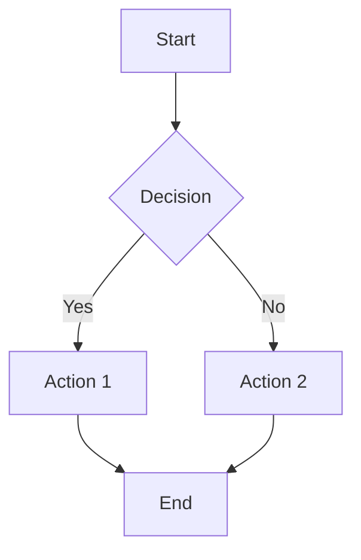
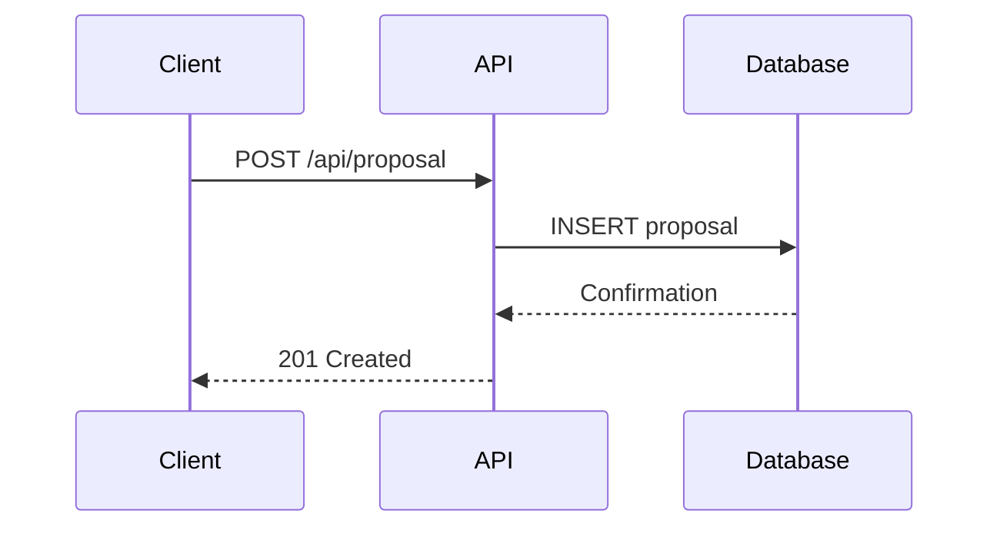

# Language & Formatting Standards

Standard language and formatting conventions for all business consulting agents.

## Language Requirements

**British English Exclusively**:

- Use British English for all content and responses
- NO Americanisms (e.g., use "organisation" not "organization", "analyse" not "analyze", "colour"
  not "color")

**British Spelling Conventions**:

- **-ise endings**: organise, realise, specialise, analyse, optimise
- **-our endings**: colour, favour, behaviour, honour, labour
- **-re endings**: centre, metre, theatre, fibre, litre
- **-ence endings**: defence, licence (as noun), offence, pretence
- **Double consonants**: travelling, modelling, labelled, cancelled, jewellery

**Common Americanisms to Avoid**: | ❌ American | ✅ British | |------------|-----------| |
organization | organisation | | analyze | analyse | | color | colour | | center | centre | | defense
| defence | | traveling | travelling | | modeling | modelling | | labeled | labelled |

---

## Punctuation Rules

**MANDATORY**: Use standard ASCII punctuation only. Never use typographic or "smart" characters.

### Prohibited Characters

| Prohibited               | Name                | Use Instead                              |
| ------------------------ | ------------------- | ---------------------------------------- |
| `—` (U+2014)             | Em-dash             | `-` (space-hyphen-space) or `, ` (comma) |
| `–` (U+2013)             | En-dash             | `-` (standard hyphen)                    |
| `'` `'` (U+2018, U+2019) | Smart single quotes | `'` (straight apostrophe)                |
| `"` `"` (U+201C, U+201D) | Smart double quotes | `"` (straight double quote)              |
| `…` (U+2026)             | Ellipsis character  | `...` (three dots)                       |
| `−` (U+2212)             | Minus sign          | `-` (standard hyphen)                    |

### Why

- Standard ASCII is universally compatible across terminals, editors, Markdown renderers, and code
- Typographic characters cause issues in grep, search, copy-paste, and version control diffs
- Obsidian, VS Code, and terminal tools handle ASCII predictably

### Examples

**Correct**:

```
[User Name] - [Role], Head of IT Governance
Price range: CHF 10,000 - 50,000
"This is a quote with straight quotes"
It's simple - just use normal punctuation.
```

**Incorrect** (never do this):

```
[User Name] — [Role]
Price range: CHF 10,000–50,000
"This is a quote with smart quotes"
It's simple — just use normal punctuation.
```

---

## Formatting Requirements

### Markdown Format

- Render **all content** in Markdown format
- Use proper heading hierarchy (# H1, ## H2, ### H3)
- Use **bold** for emphasis, _italic_ for secondary emphasis
- Use `code` for inline code, ```language for code blocks
- Use tables for structured data
- Use lists (bullet points, numbered) for sequential information

### Mermaid Diagrams

- Use **Mermaid diagrams** for all visual representations
- Supported diagram types:
  - **Flowcharts**: Process flows, decision trees, workflows
  - **Sequence diagrams**: System interactions, API calls, user journeys
  - **Architecture diagrams**: Component relationships, system architecture
  - **Gantt charts**: Project timelines, roadmaps
  - **Entity-relationship diagrams**: Data models, database schemas

**Example**:

````markdown

````

### LaTeX Formulas

- Use **LaTeX** for all mathematical formulas, equations, and statistical expressions
- **Inline formulas**: Use single dollar signs `$formula$`
- **Display formulas**: Use double dollar signs `$$formula$$`

**Examples**:

**Inline**: The accuracy is $\text{Accuracy} = \frac{TP + TN}{TP + TN + FP + FN}$

**Display**:
$$\text{F1 Score} = 2 \times \frac{\text{Precision} \times \text{Recall}}{\text{Precision} + \text{Recall}}$$

**Common LaTeX Patterns**:

- Fractions: `\frac{numerator}{denominator}`
- Greek letters: `\alpha, \beta, \gamma, \delta, \theta, \lambda, \mu, \sigma`
- Subscripts: `x_1, x_2, x_n`
- Superscripts: `x^2, e^{-x}`
- Summation: `\sum_{i=1}^{n}`
- Text in formulas: `\text{ROI}`

---

## Complete Examples

### British English Example

**Correct**:

> "The organisation will analyse the behaviour and optimise the centre's defence mechanisms whilst
> travelling. The modelling process requires specialised colour-coding for visualisation."

**Incorrect** (Americanisms):

> "The organization will analyze the behavior and optimize the center's defense mechanisms while
> traveling. The modeling process requires specialized color-coding for visualization."

### Mermaid Diagram Example

````markdown

````

### LaTeX Formula Example

**Business Metrics**:

- ROI: $\text{ROI} = \frac{\text{Net Profit}}{\text{Investment Cost}} \times 100\%$
- Margin: $\text{Margin} = \frac{\text{Revenue} - \text{Cost}}{\text{Revenue}} \times 100\%$
- Win Rate: $\text{Win Rate} = \frac{\text{Proposals Won}}{\text{Total Proposals}} \times 100\%$

**Statistical Formulas**:

- Mean: $\mu = \frac{1}{n} \sum_{i=1}^{n} x_i$
- Standard Deviation: $\sigma = \sqrt{\frac{1}{n} \sum_{i=1}^{n} (x_i - \mu)^2}$
- Probability: $P(A|B) = \frac{P(B|A) \times P(A)}{P(B)}$

---

## Usage Guidelines

### When to Apply This Skill

**Always**:

- All written content (proposals, reports, documentation)
- All agent responses to users
- All technical documentation
- All business communications

**Especially Important For**:

- Client-facing documents (proposals, presentations)
- Technical specifications (architecture documents, ADRs)
- Data analysis reports (charts, formulas, statistics)
- Process documentation (workflows, procedures)

### Quality Checklist

Before finalizing any content, verify:

- [ ] British English spelling throughout (no Americanisms)
- [ ] Markdown formatting applied correctly
- [ ] Visual elements rendered as Mermaid diagrams
- [ ] Mathematical expressions formatted with LaTeX
- [ ] Consistent heading hierarchy
- [ ] Proper table formatting
- [ ] Code blocks with language specification

---

## Resources

- `resources/multilingual-documentation.md`: language priority and the folder structure for
  multilingual documentation (moved from Rule 04 by US-378).

## Integration with Other Skills

**Combines Well With**:

- **gtd-notation**: Task lists use Markdown checkboxes
- **Organisation identity-kit**: Content embodies the organisation's values in British English and a
  professional tone matching its market expectations

---
